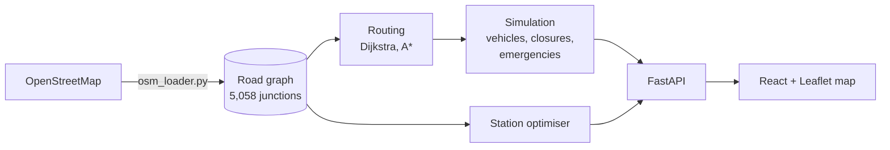

# NORWICH//SIM

[](https://github.com/samiaa10/urban-traffic-sim/actions/workflows/tests.yml)

A traffic and emergency-response simulator built on Norwich's real road network.
Vehicles drive around the city, roads can be closed, ambulances are dispatched to
emergencies, and an **optimiser** works out where a new ambulance station should go.

<!-- Add a screen recording here once you have one:

-->

**Why I built it:** I wanted a project where the interesting part is the algorithms,
not the web page. The road map is real data (5,058 junctions and 10,980 road
segments from OpenStreetMap), the routing is written from scratch, and the optimiser
answers a real question: *which station location gets help to people fastest?*

## What it does

- **Real road network:** Norwich's drivable roads, downloaded from OpenStreetMap and
  turned into a graph (junctions are nodes, road segments are edges).
- **Routing from scratch:** Dijkstra and A* (both written by hand), with
  congestion-aware costs and road closures.
- **Vehicle simulation:** vehicles follow routes at realistic speeds, one second per step.
- **Road closures with automatic rerouting:** close a road and the vehicles whose
  route uses it get new routes around it automatically. Vehicles in the middle of a
  road finish that road first, then detour. If a closure cuts a place off completely,
  the vehicle waits and the API says so instead of crashing.
- **Emergency response:** stations, ambulances, dispatch, and response times measured
  in simulated seconds. A live status panel shows the ambulance's ETA, whether it has
  been rerouted, and the final response time (see the demo below).
- **Emergency Station Optimiser:** simulates hundreds of random emergencies and ranks
  candidate station locations by average response time, worst case, and the percentage
  of emergencies reached within a target time.
- **Interactive map:** React + TypeScript + Leaflet front end to pick a route, watch
  vehicles move, close a road, and dispatch an ambulance.

## Benchmark: shortest path vs congestion-aware routing

```bash
python -m backend.routing.benchmark_congestion          # print the comparison
python -m backend.routing.benchmark_congestion --save   # also write docs/congestion_benchmark.md
```

It fills the map with traffic (a fleet heading for the city centre, driven by the real
simulation), then routes the same random journeys twice with the same A* search: once
ignoring traffic, once congestion-aware. Both routes are measured on the same traffic
snapshot: distance, free-flow travel time, vehicles passed, and search work. It also
prints how congested the scenario actually was and how many journeys changed route,
so you can see whether the traffic was heavy enough to matter. Options: `--vehicles`,
`--journeys`, `--warmup`, `--seed`.

## Demo: an ambulance meets a road closure

1. Click a start and a destination on the map, then **Calculate Route**.
2. Click **Trigger Ambulance Emergency**. The nearest ambulance is dispatched and the
   status panel shows its ETA counting down.
3. Click **Close Road Ahead of Ambulance**. A road on its route is closed (shown in
   black), the ambulance is rerouted by the same code that reroutes every other
   vehicle, and the panel shows the extra distance and time the detour costs.
4. When it arrives, the panel shows the final response time in simulated seconds.

If closing a road would cut the ambulance off completely, nothing is closed and the
app says so. The logic lives in `backend/simulation/dispatch.py` and is tested on a
tiny map in `backend/tests/test_emergency_response.py`.

## Emergency Station Optimiser: results

9 candidate locations spread evenly over Norwich, 500 random emergencies, ambulance
speed 72 km/h, target response time 8 minutes (`python -m backend.optimiser.run`,
seed 1):

| Rank | Latitude | Longitude | Average | Worst case | Reached in 8 min |
|------|----------|-----------|---------|------------|------------------|
| 1 | 52.6356 | 1.2732 | 2.7 min | 5.2 min | 100% |
| 2 | 52.6156 | 1.3112 | 3.7 min | 8.1 min | 99% |
| 3 | 52.6124 | 1.2726 | 3.7 min | 7.3 min | 100% |
| 4 | 52.6358 | 1.3190 | 3.9 min | 8.3 min | 98% |
| 5 | 52.6276 | 1.2322 | 4.0 min | 7.5 min | 100% |
| 6 | 52.6426 | 1.2282 | 4.0 min | 7.7 min | 100% |
| 7 | 52.6515 | 1.3106 | 4.1 min | 8.3 min | 98% |
| 8 | 52.6560 | 1.2753 | 4.2 min | 6.6 min | 100% |
| 9 | 52.6346 | 1.2289 | 4.2 min | 7.9 min | 100% |

The best location is clearly ahead of the others on average response time and on
worst case. The run takes about 0.3 seconds.

**Checked against the full simulation.** The optimiser works out response time as
driving distance / speed. `python -m backend.optimiser.validate` drives an ambulance
through the full simulation for 150 random station-to-emergency pairs and compares:
the simulation is on average 1.2% faster (range -6.3% to +1.1%). That's expected,
because simulated vehicles move in straight lines between junctions, which is about
1.5% shorter than the real road length on these routes.

**Why it's fast.** Working out each emergency separately would need one A* search per
(station, emergency) pair: 9 stations x 500 emergencies = 4,500 searches, an
estimated 25-30 seconds (I timed 30 individual A* searches at about 6 ms each).
Instead, the optimiser runs **one Dijkstra search from each candidate station** that
finds the distance to every junction at once, then reuses it for all 500 emergencies:
9 searches in total. I checked these distances match A* on every reachable pair I
tested.

**What it can't do (yet):**
- Emergencies are spread evenly over road junctions. Real emergencies cluster where
  more people live.
- Response time uses road length and closures but ignores traffic.
- It compares stations a person suggests; it doesn't search for the best possible spot.
- A couple of junctions sit in one-way pockets that most stations can't reach. They
  are reported as "unreached" rather than hidden.

## Routing benchmark

`python -m backend.routing.benchmark` compares Dijkstra and A* on 100 random routes
across the real Norwich graph (fixed seed, so the route set is the same every run):

| | Dijkstra | A* |
|---|---|---|
| Average junctions explored | 2,138.5 | 758.9 |

A* explores **about 65% fewer junctions** and always finds the same optimal distance
as Dijkstra. Wall-clock times depend on your machine, so run the script to see yours.

## Rerouting after a closure

When a road is closed the simulation doesn't recalculate every vehicle's route. It
first checks which vehicles' remaining routes use the closed road (a cheap check) and
only runs A* for those. `python -m backend.simulation.benchmark_rerouting` closes the
busiest road for fleets of 100, 500 and 1,000 vehicles and compares this against
recalculating everyone:

| Vehicles | Use the closed road | A* searches, affected only | A* searches, all |
|---|---|---|---|
| 100 | 22 (22%) | 22 | 100 |
| 500 | 77 (15%) | 77 | 500 |
| 1,000 | 143 (14%) | 143 | 1,000 |

That is 4.5x to 7x fewer searches. The script also measures running time and saves it
to [docs/rerouting_benchmark.md](docs/rerouting_benchmark.md); timings depend on your
machine, so re-run it to get yours. The searches still run one after another, so on a
very large fleet a closure briefly pauses the server. Running them in parallel is a
possible next step.

## How it fits together



- `backend/routing/`: the graph, Dijkstra, A*, the OpenStreetMap loader, the benchmark.
- `backend/simulation/`: vehicles, emergencies, stations, the simulation loop and
  rerouting.
- `backend/optimiser/`: the station optimiser and its command-line runner.
- `backend/api/main.py`: the FastAPI endpoints the front end talks to.
- `backend/tests/`: automated tests (road closures, emergencies, routing, optimiser).
- `frontend/`: the React + TypeScript + Leaflet map.

**How congestion works.** Each vehicle on a road segment adds 50 metres to that
segment's routing cost, so busy roads look longer and routes bend around them.

## Run it

You need Python 3 and Node.js.

```bash
# 1. Python setup (from the project folder)
python -m venv .venv
source .venv/bin/activate          # Windows: .venv\Scripts\activate
pip install -r requirements.txt

# 2. Download the Norwich road map (first time only, needs internet, can take a few minutes)
python -m backend.routing.osm_loader

# 3. Start the backend
uvicorn backend.api.main:app --reload

# 4. In a second terminal, start the front end
cd frontend
npm install
npm run dev
```

Then open the address Vite prints (usually http://localhost:5173).

Other commands:

```bash
python -m pytest backend/tests -v        # run the tests
python -m backend.optimiser.run          # station optimiser (add --help for options)
python -m backend.routing.benchmark      # Dijkstra vs A*
python -m backend.simulation.benchmark_rerouting   # cost of rerouting after a closure
python -m backend.optimiser.validate     # optimiser vs the full simulation
```

## Tests

29 automated tests cover: routes avoiding closed roads (both directions), no route
when every road is closed, vehicles waiting at a closure until it reopens, rerouting
only the affected vehicles, vehicles in the middle of a road not teleporting, ambulances
resolving emergencies (even at high speed), ambulances becoming available again,
response times in simulated seconds, and the optimiser's rankings, repeatability and
closure handling.

## Known limitations and next steps

- The simulation lives in memory and supports one run at a time.
- Congestion changes routes but isn't drawn on the map yet.
- Ambulances return to base instantly after a call instead of driving back.
- Planned: an optimiser view in the front end, running route recalculations in
  parallel, Docker, and a deployed demo.

## Data

Road data is © OpenStreetMap contributors, available under the
[Open Database Licence](https://www.openstreetmap.org/copyright).
