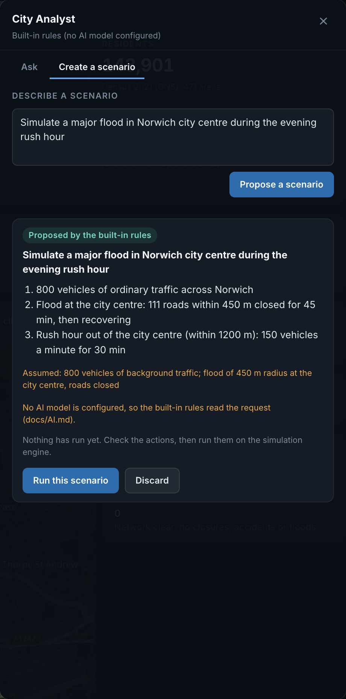

# AI City Analyst, scenarios from words, and city intelligence

NORWICH//SIM can answer questions about Norwich and its simulations, turn a
plain-language description into a scenario, and gather its analyses into
one panel. All of these work **without an AI provider**. Built-in rules then
choose the calculation and write the answer from a template. With a
provider configured, an AI model chooses the calculations and words the
answer. In both cases every number comes from the backend's own
calculations.


| Where | What |
|---|---|
| `backend/intelligence/analysis.py` | The calculated analyses (below) and the congestion-anomaly monitor |
| `backend/intelligence/tools.py` | The 8 read-only operations a model may ask for, with JSON Schemas and validation |
| `backend/intelligence/analyst.py` | The analyst: the model's tool loop, or the built-in rules |
| `backend/intelligence/scenarios.py` | Scenarios from words: proposal, validation, execution |
| `backend/intelligence/providers.py` | The provider interface, the Anthropic provider, rate limiting and errors |
| `backend/api/routes/intelligence.py` | `GET /intelligence/status`, `POST /intelligence/ask`, `GET /intelligence/insights`, `POST /intelligence/scenario/plan`, `POST /intelligence/scenario/run` |
| `frontend/src/AnalystDrawer.tsx`, `ScenarioBuilder.tsx`, `InsightsSection.tsx`, `intelligence.ts` | The drawer (top bar, **Analyst**), the scenario tab, and the **City intelligence** section |

## Configuration

All configuration is in **backend** environment variables. Nothing reaches
the frontend, and no key is ever sent to the browser.

| Variable | Meaning | Default |
|---|---|---|
| `AI_PROVIDER` | `anthropic`, `ollama` or `none` | `anthropic` if `ANTHROPIC_API_KEY` is set, otherwise `none` |
| `ANTHROPIC_API_KEY` | API key for the Anthropic provider | (unset: built-in rules) |
| `OLLAMA_BASE_URL` | Where Ollama runs (the `ollama` provider) | `http://localhost:11434` |
| `AI_MODEL` | Model id | `claude-opus-5-5`; with Ollama, `llama3.2:3b` |
| `AI_EFFORT` | `low`, `medium` or `high` | `medium` |
| `AI_TIMEOUT_SECONDS` | Per request (the Anthropic SDK retries twice) | `60`; with Ollama, `120` |
| `AI_MAX_REQUESTS_PER_MINUTE` | For the whole server | `20` |

On Render, add `ANTHROPIC_API_KEY` to the `norwich-sim-api` service's
environment. `GET /intelligence/status` and the top bar's status pill say
which mode is active and why.

The Anthropic provider uses the official `anthropic` SDK (Messages API with
tool use), with server-side refusal fallbacks enabled. A refusal, timeout,
rate limit or bad key never fails the request: the analyst says what
happened and answers with the built-in rules instead. Another vendor can be
added by implementing `Provider.respond` (a system prompt, a conversation
in block format and tool schemas in; text and tool calls out). Nothing else
needs to change.

### A free local model (Ollama)

Ollama runs an open model on your own computer, with no key and no cost.
The analyst then uses that model in place of Claude, through Ollama's chat
API with tool calling (`OllamaProvider`). It gets the same tools, the same
validation and the same fallback to the built-in rules.

1. Install Ollama from ollama.com and start it.
2. Pull a model that can call tools. `llama3.2:3b` (about 2 GB) runs on an
   8 GB laptop; on a bigger machine, a larger tool model answers better.

   ```bash
   ollama pull llama3.2:3b
   ```

3. Start the backend with the provider chosen:

   ```bash
   AI_PROVIDER=ollama .venv/bin/python -m uvicorn backend.api.main:app --port 8000
   ```

   Add `AI_MODEL=...` for another model, and `OLLAMA_BASE_URL=...` if Ollama
   runs on another computer.

The analyst's header then reads **AI: llama3.2:3b**, and answers are
labelled **AI-written from calculated results**. If Ollama is not running,
or the model has not been pulled, each answer falls back to the built-in
rules and says why (for example "Ollama is not running at
http://localhost:11434", or "run: ollama pull llama3.2:3b").

Limits of a local model:
- It only works where the backend runs on a machine with Ollama. Render's
  free plan cannot host a model, so the live site stays on the built-in
  rules.
- Small models follow the tool instructions less reliably than large ones.
  They may call a tool with wrong arguments (validation refuses it and tells
  the model) or answer without calling one.
- On a laptop, an answer can take tens of seconds.

**Not verified here:** no request has been made to a real provider while
building this. The provider adapter is tested against a stand-in client,
and the analyst's tool loop against a scripted stand-in model. Local
development here used Python 3.9 with SDK 0.125; the deployed backend runs
Python 3.12.

## Safety

- **The model cannot act on its own.** It can only name one of the 8 tools
  in `tools.py`, which are read-only analyses. Each request is checked
  against the tool's schema before it runs: unknown tools, unknown or
  missing arguments, wrong types, out-of-range values and unknown enums are
  rejected and sent back to the model as errors. The model never runs code,
  queries the database or changes a simulation.
- **Scenarios run only after confirmation.**
  - The model, or the rules, only *propose* a scenario, through the single
    `propose_scenario` tool.
  - Places must come from a fixed list of real Norwich places, and roads
    must exist on the map, so the model cannot invent coordinates.
  - The proposal is shown to the user and validated.
  - `POST /intelligence/scenario/run` refuses without `confirm: true` and
    validates the proposal again.
- **Limits:** questions up to 1,000 characters, descriptions up to 600, at
  most 5 tool rounds per answer, tool results capped at 24,000 characters,
  20 provider requests a minute for the whole server, and the same
  per-client rate limit as the other expensive endpoints
  (`backend/api/protection.py`).
- **Provenance is always shown.** Each answer is labelled either
  **"AI-written from calculated results"** (naming the model) or
  **"Calculated (built-in rules)"**, with a notice when the rules stood in
  for a failed provider. Under each answer, the calculations used are listed
  with their inputs, method and full result data. The system prompt tells
  the model to use only numbers from tool results and to label its own
  interpretation.

## What can be asked

| Question (examples) | Calculation (tool) | How it is calculated |
|---|---|---|
| Which areas have the worst emergency response coverage? | `coverage_gaps` | The planning view's hexagons: road distance from the nearest station ÷ speed, residents from Census 2021, existing OpenStreetMap stations (ambulance: the optimiser's standby sites, as stated). |
| Which station locations would improve coverage? | `recommend_station` | Each of the optimiser's 38 candidate sites added in turn to the existing stations, keeping the best by residents within the target. |
| Where are the biggest bottlenecks? | `live_bottlenecks` (live run) or `critical_roads` | Live: vehicles on each road × speed lost (the simulation's own factors). Structural: 300 trips weighted by population, fastest routes, and each busiest road closed in turn. |
| What would happen if this bridge closed? | `closure_impact` | The same trips with and without the closed roads; for the central bridges, also fire cover within 4 min (planning view). |
| Why did this simulation perform poorly? | `run_report` | The live run's figures (held up, speed, reroutes, closures, accidents, floods, emergency response) and its most delayed roads; each finding quotes its figure. |
| Which scenario produced the best results? | `scenario_results` | The newest completed saved study's ranking and explanation (needs the database). |
| Anything else | `city_overview` | The model's figures, and what can be asked. |

## Scenarios from words

**Create a scenario** in the analyst turns a description into supported
actions:
- **Traffic:** background traffic and rush-hour surges into or out of a
  place.
- **Floods:** every road within a radius closed or slowed, then recovering.
- **Closures:** named roads, or the central bridges.
- **Emergency incidents:** answered by the command centre's fleet.

The proposal lists each action in words, with any assumption made (sizes,
durations, places). **Run this scenario** starts a new live run of the real
engine with those actions applied by the engine's own code, and reports the
closures' measured effect on 200 sampled trips. **Watch it in the command
centre** opens that run.

Requests the engine cannot simulate (weather, earthquakes, public
transport and so on) are refused with an explanation of what is supported.



## City intelligence (analyses and recommendations)

The **City intelligence** section runs the analyses on request:
- fire and police coverage within 4 minutes, and the slowest areas;
- the single extra station that would help most (**recommendation**);
- the roads Norwich's trips depend on (**vulnerability**);
- for the live run: its findings (**automated explanation**), bottlenecks
  and **congestion anomalies**.

Scenario comparisons are in the Scenarios section, and the analyst can
summarise the newest one.

**Anomaly detection** (`CongestionMonitor`): every 5 simulated seconds, each
road's vehicle count updates its own exponentially weighted mean and
variance (α = 0.05). After 2 minutes of warm-up, a road is flagged when it
has at least 6 vehicles and is 3 standard deviations above its own mean. It
is cleared once traffic falls back. This is a statistical rule applied to
the simulation's own data, not a trained model. No predictive model was
added, because there is no real observed traffic data to train or test one
against.


## Verified results (built-in rules, no AI provider)

These come from the Norwich map, with the 4-minute target used in the
planning view:

| Analysis | Result |
|---|---|
| Fire cover within 4 min | 91.6% of residents (12,051 beyond); the most residents beyond the target are near Bowthorpe and Heartsease |
| Best extra fire station | About 0.9 km from Bowthorpe: 97.7% (+8,716 residents), best of 38 sites |
| Police cover within 4 min | 98.3%; one more station near Bowthorpe would make it 100% |
| Busiest road for trips | Dereham Road (17% of 300 sampled trips; closing it adds 12 s to each on average) |
| Central bridges closed | 21.6% of sampled trips longer, by 37 s on average (worst 104 s); fire cover within 4 min unchanged (91.6%) |

## Limits

- The analyses inherit the model's simplifications: free-flow speeds and
  fixed service speeds for coverage and trips, and the simulation's own
  traffic model for live runs. None of this predicts real response times
  or real traffic.
- Place names come from approximate district centres, used only to say
  roughly where something is.
- Without a provider, the rules recognise common phrasings only. Unusual
  questions get the city overview and a list of what can be asked.
- Saved scenario studies need the database.
