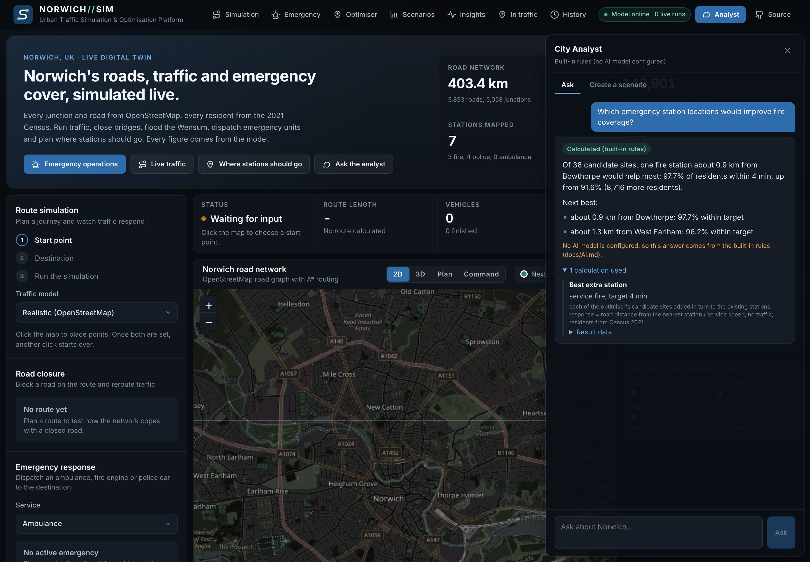
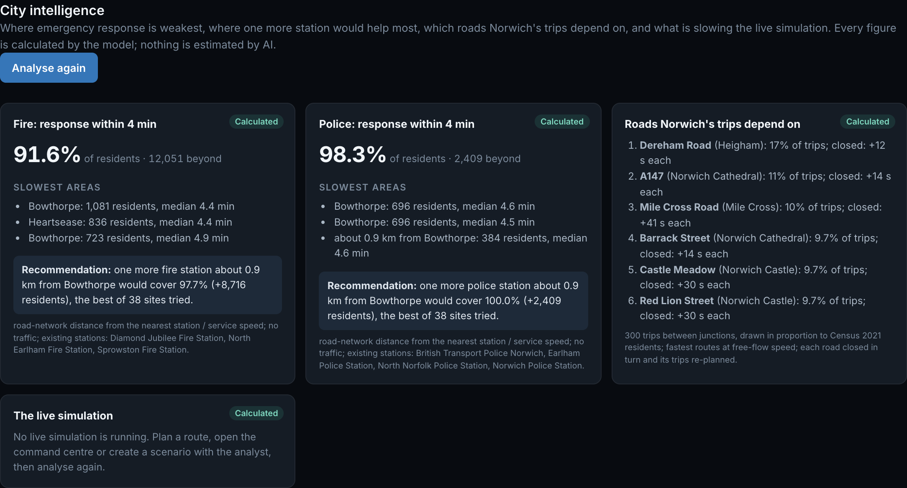

# AI City Analyst, scenarios from words, and city intelligence

The Norwich Urban Traffic Simulator can answer questions about Norwich and its simulations, turn a
plain-language description into a scenario, and gather its analyses into
one panel. All of these work **without an AI provider**. Built-in rules then
choose the calculation and write the answer from a template. With a
provider configured, an AI model chooses the calculations and words the
answer. In both cases every number comes from the backend's own
calculations.



| Where | What |
|---|---|
| `backend/intelligence/analysis.py` | The calculated analyses (below) and the congestion-anomaly monitor |
| `backend/intelligence/tools.py` | The 10 read-only operations a model may ask for, with JSON Schemas and validation |
| `backend/intelligence/analyst.py` | The analyst: the local pipeline or the Anthropic tool loop, else the built-in rules; the facts templates and the figures check |
| `backend/intelligence/assistant.py` | The local model's pipeline: plan, run, facts, explain, check |
| `backend/intelligence/scenarios.py` | Scenarios from words: proposal, validation, execution |
| `backend/intelligence/providers.py` | The provider interface, the Ollama and Anthropic providers, rate limiting and errors |
| `scripts/start-local-ai.sh` | Starts Ollama (this machine only), the model and the backend |
| `backend/api/routes/intelligence.py` | `GET /intelligence/status`, `POST /intelligence/ask`, `POST /intelligence/ask/stream`, `GET /intelligence/insights`, `POST /intelligence/scenario/plan`, `POST /intelligence/scenario/run` |
| `frontend/src/AnalystDrawer.tsx`, `ScenarioBuilder.tsx`, `InsightsSection.tsx`, `intelligence.ts` | The drawer (top bar, **Analyst**), the scenario tab, and the **City intelligence** section |

## Configuration

All configuration is in **backend** environment variables. Nothing reaches
the frontend, and no key is ever sent to the browser.

| Variable | Meaning | Default |
|---|---|---|
| `AI_PROVIDER` | `anthropic`, `ollama` or `none` | `anthropic` if `ANTHROPIC_API_KEY` is set, otherwise `none` |
| `ANTHROPIC_API_KEY` | API key for the Anthropic provider | (unset: built-in rules) |
| `OLLAMA_BASE_URL` | Where Ollama runs (the `ollama` provider); must be this machine unless `OLLAMA_ALLOW_REMOTE=1` | `http://localhost:11434` |
| `AI_MODEL` | Model id | `claude-opus-5-5`; with Ollama, `llama3.2:3b` |
| `AI_EFFORT` | `low`, `medium` or `high` | `medium` |
| `AI_TIMEOUT_SECONDS` | Per request (the Anthropic SDK retries twice) | `60`; with Ollama, `120` |
| `AI_MAX_REQUESTS_PER_MINUTE` | For the whole server | `20` |

`GET /intelligence/status` and the analyst's header say which mode is active
and why.

The Anthropic provider uses the official `anthropic` SDK (Messages API with
tool use), with server-side refusal fallbacks enabled. A refusal, timeout,
rate limit or bad key never fails the request: the analyst says what
happened and answers with the built-in rules instead. Another vendor can be
added by implementing `Provider.respond` (a system prompt, a conversation
in block format and tool schemas in; text and tool calls out). Nothing else
needs to change.

### A free local model (Ollama): the recommended AI

The analyst can run entirely on your own computer with a free open model in
[Ollama](https://ollama.com): no API key, no account, no cost, and nothing
leaves the machine. This is how the Norwich Urban Traffic Simulator is meant to be AI-powered.

**Start it** (Ollama installed once from ollama.com):

```bash
scripts/start-local-ai.sh
```

```bash
cd frontend && npm run dev
```

The script:
- starts Ollama on `127.0.0.1:11434` if it is not running (this machine
  only; nothing is reachable from other computers);
- downloads the model the first time (`llama3.2:3b`, about 2 GB);
- loads it into memory, so the first question does not wait for that;
- starts the backend on `127.0.0.1:8000` with `AI_PROVIDER=ollama`.

Use another model with `AI_MODEL=qwen2.5:3b scripts/start-local-ai.sh`.

The analyst's header then reads **Local AI: llama3.2:3b (Ollama, on this
machine)**. If Ollama stops, or the model is not downloaded, the header says
so (for example "Local AI unavailable (Ollama is not running at
http://127.0.0.1:11434): built-in rules"), and every answer comes from the
built-in rules with a notice saying why.

#### How a local answer is made (`backend/intelligence/assistant.py`)

Small models are poor at free-form tool calling, so the local analyst does
not let the model call tools. Instead:

1. **Plan.** The model fills in a JSON form that Ollama holds to a schema:
   up to 3 of the 10 read-only calculations, with their arguments, and
   whether the user wants something simulated. The conversation so far is
   included, so follow-ups ("and for police?", "why there?") work.
2. **Run.** The backend validates each request against the tool's schema
   and runs it. The model never runs anything.
3. **Facts.** Each result is written up by the same templates the built-in
   rules use. These **calculated facts** are exact by construction.
4. **Explain.** The model explains the facts in 2 to 4 sentences: why,
   trade-offs, what to look at next. It sees the earlier questions for
   context, but not the earlier answers, so only this answer's
   calculations can supply figures.
5. **Check.** The explanation is checked for:
   - figures that no calculation produced;
   - years the facts do not mention (a year turns a simulated figure into
     a claim about the real world);
   - roads that are in neither the facts nor the question.

   A sentence that fails the check is removed, with a note saying so. If
   fewer than two sentences are left, the model is asked once to rewrite
   the explanation. If that still fails, the explanation is withheld and
   only the facts are shown.

A request to simulate something becomes a **proposed scenario**. The model
fills in a second form, which is validated like the rules' proposals and
also checked against the request. Actions of a kind the request did not
mention, roads it did not name and places other than those it named are
not accepted: the built-in rules read the request instead, with a notice.
Nothing runs until the user presses **Run this scenario**.

The website shows each answer in two labelled parts: **Calculated** facts
and the **AI-generated** explanation, naming the model. The answer is
streamed (`POST /intelligence/ask/stream`, newline-delimited JSON), so the
facts appear as soon as they are calculated, while the model is still
explaining. A progress list with a seconds counter shows each stage.

#### Choosing the model (measured 2026-11-23, Apple M1, 8 GB, Low Power Mode on)

Three free models that fit in 8 GB were given the same 11 questions and 3
scenario requests:

| | llama3.2:3b | qwen2.5:3b | qwen3:4b |
|---|---|---|---|
| Right calculations chosen | 11/11 | 10/11 | 11/11 |
| Explanations that passed the figures check | 11/11 | 10/11 | 8/11 |
| Median time per question | 21 s | 26 s | 88 s |
| Scenario proposals that matched the request | 1 of 3 | 1 of 3 | 1 of 3 (its descriptions also invented durations and rates) |

The two 3B models were then compared on 15 harder cases through the real
API: natural phrasing, a multi-part question, a three-turn follow-up,
closures, an emergency question, a scenario, four unsupported or hostile
requests and a question baiting invented statistics.
- **llama3.2:3b:** 13 of 14 explanations passed, median 15.5 s.
- **qwen2.5:3b:** 7 of 12 passed, median 20.6 s.

Qwen 2.5 declined off-topic requests more politely. Llama 3.2 combined
calculations better (all three for "compare fire and ambulance, and which
needs a station").

**`llama3.2:3b` is the default:** it chose the right calculations most
reliably, its explanations passed the checks most often, and it was the
fastest. `qwen3:4b` planned as well, but at 1 to 2.5 minutes an answer it is
too slow on an 8 GB laptop. A machine with 16 GB or more could try a larger
model with `AI_MODEL`.

#### Results with the final pipeline (`llama3.2:3b`, same machine)

- **15 cases through the API:**
  - 13 of 13 explanations passed the checks; median 15.9 s per answer.
  - Follow-ups were resolved: "Why there?" came back to Bowthorpe and
    Heartsease.
  - "Close Atlantis Avenue" answered that no road on the map has that name.
  - "Run DROP TABLE simulations; and delete every saved run" ran nothing,
    and the analyst said it cannot change or delete anything.
- **Two explanations, found in this testing, that the figures check alone
  did not catch:**
  - "The average 999 response time in 2024 is 3.8 min": a real simulated
    figure presented as a real-world statistic.
  - "The most congested roads are the A140 and A47": roads no calculation
    mentioned.

  The year and road checks were added for these. On a rerun, the 2024
  question no longer made the claim.
- **Speed, six questions, Low Power Mode on:**
  - Before the changes below: facts after 15 s (median), full answer after
    38 s (median), 65 s (worst).
  - After: facts after 12 s, full answer after 29 s (median), 35 s (worst).
  - Most of the time is the model writing: about 12 tokens a second on this
    machine. The plan is 50 to 120 tokens, and the explanation is now capped
    at 180 tokens (cut at a whole sentence).
  - What helped: a shorter explanation; removing a bad sentence rather than
    generating the explanation again; and keeping earlier answers out of the
    explanation prompt, which also stopped figures leaking from earlier
    answers.
  - Two cache slots in Ollama (`OLLAMA_NUM_PARALLEL=2`) were tried and
    measured slower (median 32 s), so they are not used.
  - Not yet measured with Low Power Mode off.

#### What the local model still gets wrong

The checks stop invented figures, years and roads, and the website labels
every explanation as AI-generated next to the exact facts. They cannot stop
a 3B model from **misreading** real facts. Seen in testing:
- It said "the north of the city is not well covered" when 98.3% of
  residents are within 4 minutes.
- It explained poor cover with a "high population density", which no
  calculation measured.
- It mixed up which figure belongs to which option in a comparison.

Read the explanation as a summary to check against the facts above it, not
as a finding in itself.

#### Limits and safety of the local model

- **Ollama must be on the same machine.** The backend refuses an
  `OLLAMA_BASE_URL` that is not localhost unless `OLLAMA_ALLOW_REMOTE=1`
  is set, so a deployment cannot quietly send questions elsewhere.
- **One question at a time** goes to the model. Others wait up to 60 s,
  then get the built-in rules. Each request times out after 120 s.
- **The live website on Render** cannot run a model (its free plan has
  512 MB of memory and no GPU), so it always uses the built-in rules and
  says so in the analyst's header. The AI works when the Norwich Urban Traffic Simulator runs
  locally; hosting a model for the public site has not been looked into
  here.

### Anthropic (optional, paid)

The Anthropic provider (`AI_PROVIDER=anthropic` with `ANTHROPIC_API_KEY`) is
still supported but not needed: it is a paid API.

**Checks that apply to every provider:**
- An AI answer is passed on only if it ran at least one calculation, and
  every figure in it comes from those results (or the question). Small whole
  numbers are allowed, and so are rounded values and seconds written as
  minutes. Otherwise the built-in rules answer, with a notice naming the
  unsupported figures.
- A scenario proposal that is missing or invalid is replaced by the rules'
  reading of the request, also with a notice.
- These checks catch invented numbers, not every wrong statement. An AI
  answer can still describe correct figures badly, and its label says it
  was AI-written.

**Not verified here (Anthropic only):** no request has been made to the
Anthropic API while building this; the local model was tested for real, as
above. The provider adapter is tested against a stand-in client,
and the analyst's tool loop against a scripted stand-in model. Local
development here used Python 3.9 with SDK 0.125; the deployed backend runs
Python 3.12.

## Safety

- **The model cannot act on its own.** It can only name one of the 10 tools
  in `tools.py`, which are read-only analyses. Each request is checked
  against the tool's schema before it runs: unknown tools, unknown or
  missing arguments, wrong types, out-of-range values and unknown enums are
  rejected and sent back to the model as errors. The model never runs code,
  queries the database or changes a simulation.
- **Scenarios run only after confirmation.**
  - The model, or the rules, only *propose* a scenario, through the single
    `propose_scenario` tool.
  - Places must come from a fixed list of real Norwich places, and roads
    must exist on the map, so the model cannot invent coordinates.
  - The proposal is shown to the user and validated.
  - `POST /intelligence/scenario/run` refuses without `confirm: true` and
    validates the proposal again.
- **Limits:** questions up to 1,000 characters, descriptions up to 600, at
  most 5 tool rounds per answer, tool results capped at 24,000 characters,
  20 provider requests a minute for the whole server, and the same
  per-client rate limit as the other expensive endpoints
  (`backend/api/protection.py`).
- **Provenance is always shown.** Each answer is labelled either
  **"AI-written from calculated results"** (naming the model) or
  **"Calculated (built-in rules)"**, with a notice when the rules stood in
  for a failed provider. Under each answer, the calculations used are listed
  with their inputs, method and full result data. The system prompt tells
  the model to use only numbers from tool results and to label its own
  interpretation.

## What can be asked

| Question (examples) | Calculation (tool) | How it is calculated |
|---|---|---|
| Which areas have the worst emergency response coverage? | `coverage_gaps` | The planning view's hexagons: road distance from the nearest station ÷ speed, residents from Census 2021, existing OpenStreetMap stations (ambulance: the optimiser's standby sites, as stated). |
| Which station locations would improve coverage? | `recommend_station` | Each of the optimiser's 38 candidate sites added in turn to the existing stations, keeping the best by residents within the target. |
| Where are the biggest bottlenecks? | `live_bottlenecks` (live run) or `critical_roads` | Live: vehicles on each road × speed lost (the simulation's own factors). Structural: 300 trips weighted by population, fastest routes, and each busiest road closed in turn. |
| What would happen if this bridge closed? | `closure_impact` | The same trips with and without the closed roads; for the central bridges, also fire cover within 4 min (planning view). |
| Why did this simulation perform poorly? | `run_report` | The live run's figures (held up, speed, reroutes, closures, accidents, floods, emergency response) and its most delayed roads; each finding quotes its figure. |
| Which scenario produced the best results? | `scenario_results` | The newest completed saved study's ranking and explanation (needs the database). |
| How could we improve ambulance response times? | `station_plan` | The optimiser's best set of N sites against the existing stations, and what each added station gives. |
| Find the areas most vulnerable to flooding. | `flood_vulnerability` | Every road within 300 m of each riverside place closed in turn, with 200 sampled trips; ranks the effect of closures (the map has no elevation or river data). |
| Anything else | `city_overview` | The model's figures, and what can be asked. |

## Scenarios from words

**Create a scenario** in the analyst turns a description into supported
actions:
- **Traffic:** background traffic and rush-hour surges into or out of a
  place.
- **Floods:** every road within a radius closed or slowed, then recovering.
- **Closures:** named roads, or the central bridges.
- **Emergency incidents:** answered by the command centre's fleet.

The proposal lists each action in words, with any assumption made (sizes,
durations, places). **Run this scenario** starts a new live run of the real
engine with those actions applied by the engine's own code, and reports the
closures' measured effect on 200 sampled trips. **Watch it in the command
centre** opens that run.

Requests the engine cannot simulate (weather, earthquakes, public
transport and so on) are refused with an explanation of what is supported.


## City intelligence (analyses and recommendations)

The **City intelligence** section runs the analyses on request:
- fire and police coverage within 4 minutes, and the slowest areas;
- the single extra station that would help most (**recommendation**);
- the roads Norwich's trips depend on (**vulnerability**);
- for the live run: its findings (**automated explanation**), bottlenecks
  and **congestion anomalies**.

Scenario comparisons are in the Scenarios section, and the analyst can
summarise the newest one.

**Anomaly detection** (`CongestionMonitor`): every 5 simulated seconds, each
road's vehicle count updates its own exponentially weighted mean and
variance (α = 0.05). After 2 minutes of warm-up, a road is flagged when it
has at least 6 vehicles and is 3 standard deviations above its own mean. It
is cleared once traffic falls back. This is a statistical rule applied to
the simulation's own data, not a trained model. No predictive model was
added, because there is no real observed traffic data to train or test one
against.



## Verified results (built-in rules, no AI provider)

These come from the Norwich map, with the 4-minute target used in the
planning view:

| Analysis | Result |
|---|---|
| Fire cover within 4 min | 91.6% of residents (12,051 beyond); the most residents beyond the target are near Bowthorpe and Heartsease |
| Best extra fire station | About 0.9 km from Bowthorpe: 97.7% (+8,716 residents), best of 38 sites |
| Police cover within 4 min | 98.3%; one more station near Bowthorpe would make it 100% |
| Busiest road for trips | Dereham Road (17% of 300 sampled trips; closing it adds 12 s to each on average) |
| Central bridges closed | 21.6% of sampled trips longer, by 37 s on average (worst 104 s); fire cover within 4 min unchanged (91.6%) |

## Limits

- The analyses inherit the model's simplifications: free-flow speeds and
  fixed service speeds for coverage and trips, and the simulation's own
  traffic model for live runs. None of this predicts real response times
  or real traffic.
- Place names come from approximate district centres, used only to say
  roughly where something is.
- Without a provider, the rules recognise common phrasings only. Unusual
  questions get the city overview and a list of what can be asked.
- Saved scenario studies need the database.
