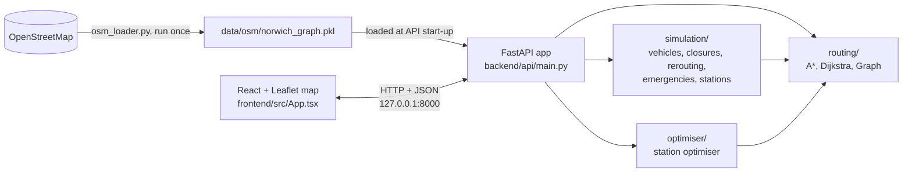

# Architecture

This document explains how NORWICH//SIM is organised, so another developer can find their way around the code. For setup and run instructions, see the [README](../README.md).

## Overview

The project has two parts that talk over HTTP:

- **Backend** (`backend/`): Python. It holds the road graph, calculates routes, runs the simulation, and exposes everything through a FastAPI app.
- **Frontend** (`frontend/`): React + TypeScript. It draws the map and calls the backend.



The Norwich data is downloaded once and saved as a pickle file. The API loads it when it starts, and the benchmark and optimiser scripts load it themselves. See [Road-network data](../README.md#road-network-data).

## Folder guide

```
backend/
├── api/
│   └── main.py                 FastAPI app: every HTTP endpoint, CORS, graph loading
├── routing/
│   ├── graph.py                Graph class (nodes with lat/lon, weighted directed edges)
│   ├── osm_loader.py           Downloads the Norwich network and saves it as a pickle
│   ├── a_star.py               A* search; optional traffic penalty and blocked roads
│   ├── dijkstra.py             Dijkstra search (used for comparison and benchmarking)
│   ├── benchmark.py            Dijkstra vs A* on random journeys
│   ├── benchmark_congestion.py Shortest-path vs congestion-aware routing
│   └── routing_demo.py         Tiny standalone Dijkstra/A* demo on a 5-node graph
├── simulation/
│   ├── simulation.py           Simulation class: vehicles, time, closures, emergencies, stations
│   ├── vehicle.py              Vehicle that follows a route
│   ├── rerouting.py            Finds vehicles affected by a closure and gives them new routes
│   ├── emergency.py            Emergency (location, state, response time)
│   ├── station.py              EmergencyStation (holds available emergency vehicles)
│   ├── dispatch.py             Emergency status, and the "close a road ahead of the ambulance" scenario
│   └── benchmark_rerouting.py  Affected-only vs recalculate-all rerouting benchmark
├── optimiser/
│   ├── station_optimiser.py    Ranks candidate station locations
│   ├── run.py                  Command-line interface for the optimiser
│   └── validate.py             Compares optimiser estimates with the full simulation
└── tests/                      pytest suite (+ helpers.py with tiny test road networks)

frontend/
├── src/App.tsx                 The whole interface: map, controls, simulation loop, API calls
├── src/main.tsx                React entry point
└── vite.config.ts, package.json, tsconfig*.json, eslint.config.js

docs/                           This file, the demo guide, and saved benchmark reports
.github/workflows/tests.yml     CI: runs the backend tests on every push and pull request
```

## Key ideas

### The graph

`routing/graph.py` is a small custom class. Each node (junction) has a latitude and longitude, and each directed edge has a length in metres. Because OpenStreetMap roads can be one-way, a route from A to B may exist while B to A does not.

### Routing

`a_star` takes the graph, a start and a destination, and optionally `traffic` and `blocked_segments`:

- The heuristic is the great-circle distance to the destination.
- With `traffic`, each vehicle on a road adds `CONGESTION_PENALTY_METRES` (50 m) to that road's cost.
- With `blocked_segments`, those roads are skipped.
- With `return_stats=True` it also returns how many nodes it explored.

Dijkstra exists so A\* can be checked against it. Both must return the same distance without traffic.

### Road segments are identified by coordinates

A road segment is represented as a tuple of its two end points' `(latitude, longitude)` pairs, sorted so direction does not matter (`get_segment` in `a_star.py`, `segment_key` in `rerouting.py`). That is why closing a road blocks it in both directions. `rerouting.build_node_lookup` maps a coordinate pair back to its junction id, which the API builds once at start-up.

### Simulation time

`Simulation.time` goes up by 1 for every `step()`, which is one simulated second. Emergency response times use this simulated time rather than the computer's clock, so they don't depend on how fast the frontend polls. The frontend advances the simulation by repeatedly calling `POST /simulation/step`.

### Rerouting

When a road closes, `rerouting.reroute_affected_vehicles` first checks which vehicles' remaining routes use that road. This check is cheap. A\* only runs for those vehicles. A vehicle in the middle of a road finishes that road first, so the new route starts at the next junction it will reach. A vehicle with no alternative keeps its route (and waits at the closure until it reopens). The rerouting benchmark compares this against recalculating every vehicle.

### Emergencies

1. `add_station` creates an `EmergencyStation`, and `add_emergency_vehicle` puts an ambulance in it.
2. `create_emergency` records an emergency at a location, and `dispatch_from_nearest_station` sends the nearest available ambulance.
3. The API calculates the ambulance's route with A\*, using current traffic and closures, and gives it to the vehicle.
4. When the ambulance reaches the emergency, the emergency is resolved and the response time is recorded in simulated seconds. The ambulance becomes available again.
5. `dispatch.block_road_ahead` closes a road on the ambulance's route ahead of it and reroutes it using the same rerouting code as any other vehicle. It reports the extra distance and time of the detour.

`dispatch.py` deliberately has no FastAPI code in it, so the scenario can be tested on a tiny map.

### Station optimiser

For each candidate location, `station_optimiser.py` runs one Dijkstra search to get the distance to every junction. It reuses the same random emergencies for every candidate, so the comparison is fair. Response time is distance divided by ambulance speed. This is what keeps it fast: one search per candidate rather than one per emergency. `validate.py` checks the estimate against ambulances driven through the full simulation.

## API endpoints

All defined in `backend/api/main.py`. FastAPI generates interactive docs at `/docs`. Endpoints that act on the simulation return 404 if no simulation has been started.

| Method | Path | Purpose |
|---|---|---|
| GET | `/` | Health check (`{"name": "NORWICH//SIM", "status": "online"}`) |
| GET | `/nearest-node?latitude&longitude` | Nearest junction to a point |
| GET | `/route?start&destination` | A\* route between two junction ids. Uses the running simulation's traffic and closures if there is one. |
| POST | `/simulation/start?start&destination` | Start a simulation with a vehicle from start to destination, plus one coming back if a return route exists |
| GET | `/simulation/state` | Position and progress of vehicle 0 |
| POST | `/simulation/step` | Advance one simulated second, return all vehicles |
| GET | `/simulation/congestion` | Vehicle count and congestion level per road segment |
| POST | `/simulation/reroute?vehicle_id` | Recalculate one vehicle's route using traffic and closures |
| POST | `/incident/block?start&destination` | Close the road between two adjacent junctions and reroute affected vehicles |
| POST | `/incident/unblock?start&destination` | Reopen a closed road |
| GET | `/incidents` | List closed roads |
| POST | `/station/create?latitude&longitude&station_type` | Add an emergency station |
| POST | `/station/add-vehicle?station_id&speed&vehicle_type` | Add an emergency vehicle to a station |
| POST | `/emergency/create?latitude&longitude&emergency_type` | Create an emergency and dispatch the nearest available vehicle |
| GET | `/emergency/status` | State, ETA, response time and reroutes for every emergency |
| POST | `/emergency/block-ahead` | Close a road ahead of the ambulance and reroute it |
| GET | `/optimiser/stations?candidates&scenarios&seed&target_seconds&speed` | Rank candidate station locations (2 to 20 candidates, written as `lat,lon;lat,lon`) |

## Frontend

The frontend is a single React component file, `frontend/src/App.tsx`, using `react-leaflet` for the map. It calls the backend at `http://127.0.0.1:8000` (hard-coded), converts chosen map locations (latitude/longitude) into junction ids with `/nearest-node`, and runs the simulation by stepping the backend and re-drawing vehicles and congestion. It also polls `/emergency/status`. The backend's CORS setting only allows the origin `http://localhost:5173`.

## Testing

Tests live in `backend/tests/` and use tiny hand-built graphs from `helpers.py`, so they run in well under a second without the Norwich data. Each test file matches an area: `test_routing`, `test_road_closures`, `test_rerouting`, `test_emergency`, `test_emergency_response`, `test_station_optimiser` and `test_benchmark_congestion`. GitHub Actions runs `python -m pytest backend/tests -v` on every push and pull request.

## Known design trade-offs

- The simulation is a module-level variable in `main.py`, which keeps the code simple but means one simulation per server process.
- The pickle format is quick to load but couples the data file to the `Graph` class and is not safe to load from untrusted sources.
- `frontend/src/App.tsx` holds all the UI logic in one file. Splitting it into components and a small API client would be a natural clean-up.
