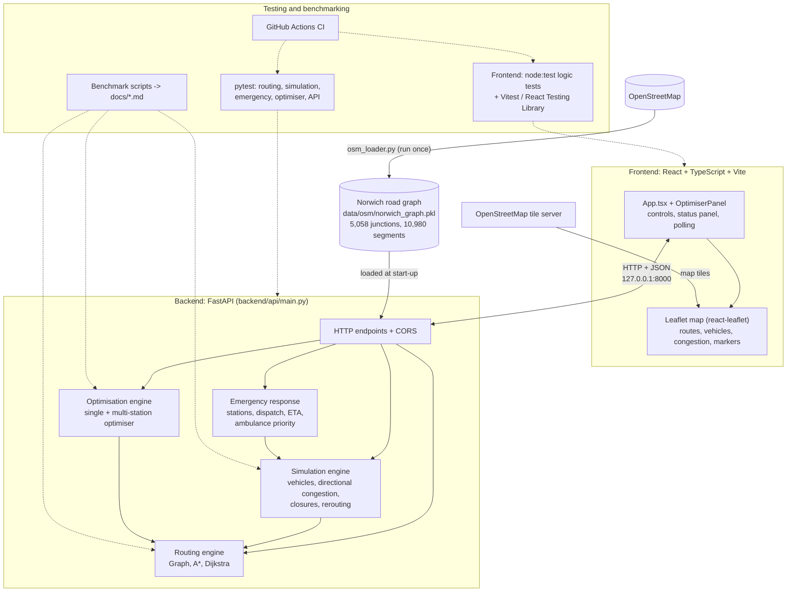

# Architecture

This document explains how NORWICH//SIM is organised, so another developer can find their way around the code. For setup and run instructions, see the [README](../README.md).

## Overview

The project has two parts that talk over HTTP:

- **Backend** (`backend/`): Python. It holds the road graph, calculates routes, runs the simulation, and exposes everything through a FastAPI app.
- **Frontend** (`frontend/`): React + TypeScript. It draws the map and calls the backend.



The Norwich data is downloaded once and saved as a pickle file. The API loads it when it starts, and the benchmark and optimiser scripts load it themselves. See [Road-network data](../README.md#road-network-data).

## Folder guide

```
backend/
├── api/
│   └── main.py                 FastAPI app: every HTTP endpoint, CORS, graph loading
├── routing/
│   ├── graph.py                Graph class (nodes with lat/lon, weighted directed edges)
│   ├── osm_loader.py           Downloads the Norwich network and saves it as a pickle
│   ├── a_star.py               A* search; optional traffic penalty and blocked roads
│   ├── dijkstra.py             Dijkstra search (used for comparison and benchmarking)
│   ├── benchmark.py            Dijkstra vs A* on random journeys
│   ├── benchmark_congestion.py Shortest-path vs congestion-aware routing
│   └── routing_demo.py         Tiny standalone Dijkstra/A* demo on a 5-node graph
├── simulation/
│   ├── simulation.py           Simulation class: vehicles, time, closures, traffic and slowdown, emergencies, stations
│   ├── vehicle.py              Vehicle that follows a route (slows down when told the road is busy)
│   ├── rerouting.py            Finds vehicles affected by a closure and gives them new routes
│   ├── emergency.py            Emergency (location, state, response time)
│   ├── station.py              EmergencyStation (holds available emergency vehicles)
│   ├── dispatch.py             Emergency status (congestion-aware ETA), and the "close a road ahead of the ambulance" scenario
│   ├── benchmark_rerouting.py  Affected-only vs recalculate-all rerouting benchmark
│   └── benchmark_performance.py Throughput, memory, several closures, optimiser runtime (writes docs/performance_benchmark.md)
├── optimiser/
│   ├── station_optimiser.py    Ranks candidate station locations, chooses SETS of stations, baselines, explanations
│   ├── run.py                  Command-line interface for the optimiser (--stations N for a set)
│   ├── validate.py             Compares optimiser estimates with the full simulation
│   └── evaluate.py             Audit tool: compares the optimiser's pick with baselines, checks it is stable, checks multi-station choice against trying every set
└── tests/                      pytest suite (+ helpers.py with tiny test road networks)

frontend/
├── src/App.tsx                 The main interface: map, controls, simulation loop, API calls
├── src/simulationHelpers.ts    Plain functions App uses: status text, emergency text, traffic summary, route conversion
├── src/OptimiserPanel.tsx      Station optimiser controls and map markers (single-station and station-set)
├── src/OptimiserResults.tsx    The optimiser's result tables and text (no Leaflet, so testable)
├── src/optimiser.ts            Optimiser response types, requests, error handling, number formatting
├── src/main.tsx                React entry point
├── tests/                      Logic tests (Node's test runner, `npm run test:unit`)
├── ui-tests/                   Interaction tests (Vitest + jsdom + React Testing Library, `npm run test:ui`)
├── Dockerfile                  Frontend image (Vite dev server)
└── vite.config.ts, vitest.config.ts, package.json, tsconfig*.json, eslint.config.js

docs/                           This file, the demo guide, saved benchmark reports, portfolio notes
docker-compose.yml, backend/Dockerfile   Optional: run both servers in containers
.github/workflows/tests.yml     CI: backend tests (Python 3.9 and 3.11), frontend lint, build and tests
```

## Key ideas

### The graph

`routing/graph.py` is a small custom class. Each node (junction) has a latitude and longitude, and each directed edge has a length in metres. Because OpenStreetMap roads can be one-way, a route from A to B may exist while B to A does not.

### Routing

`a_star` takes the graph, a start and a destination, and optionally `traffic` and `blocked_segments`:

- The heuristic is the great-circle distance to the destination.
- With `traffic`, each vehicle on a road adds `CONGESTION_PENALTY_METRES` (50 m) to that road's cost.
- With `blocked_segments`, those roads are skipped.
- With `return_stats=True` it also returns how many nodes it explored.

Dijkstra exists so A\* can be checked against it. Both must return the same distance without traffic.

### Road segments are identified by coordinates

A road segment is represented as a tuple of its two end points' `(latitude, longitude)` pairs, sorted so direction does not matter (`get_segment` in `a_star.py`, `segment_key` in `rerouting.py`). That is why closing a road blocks it in both directions. `rerouting.build_node_lookup` maps a coordinate pair back to its junction id, which the API builds once at start-up.

### Simulation time

`Simulation.time` goes up by 1 for every `step()`, which is one simulated second. Emergency response times use this simulated time rather than the computer's clock, so they don't depend on how fast the frontend polls. The frontend advances the simulation by repeatedly calling `POST /simulation/step`.

### Congestion and vehicle movement

Congestion is not only drawn on the map, it changes how vehicles move:

1. At the start of every `step()`, `get_traffic_density()` counts the vehicles on each road segment **once**, before anyone moves. Every vehicle sees the same snapshot, so the order of the vehicle list cannot change the result.
2. `congestion_level(count)` turns a count into a level (`clear`, `light`, `moderate`, `heavy`). The map colours roads by this level, and `SPEED_FACTORS` turns the same level into a fraction of full speed: 1.0 for clear or light (a lone vehicle is never slowed), 0.6 for moderate, 0.3 for heavy.
3. `Vehicle.move(time, is_blocked, speed_factor)` takes an optional function giving the speed factor for the road it is on. Movement is time-based: it works out how long the rest of the current road takes at the reduced speed, and carries any leftover time on to the next road. Without the function a vehicle drives at full speed, as before.
4. Each vehicle keeps `journey_seconds`, a clock that runs every step until it arrives, including time stuck behind a closed road. Congestion and closures both lengthen a journey, and `/simulation/step` reports `speed_factor` and `journey_seconds` per vehicle.
5. `dispatch.remaining_seconds` computes an ambulance's ETA the same way, using each remaining road's current speed factor, so the ETA shown in the status panel grows when the route is congested. It counts only traffic going the same way, and for an ambulance on a call it ignores traffic (ambulance priority), matching how `step()` moves it.

Speed is driven by `get_directional_traffic`, which counts each direction of a road separately (`directed_segment`), while the map colours and routing penalty still use the merged `segment_between` key. Ambulances with `on_emergency` set ignore traffic. Simplifications: a vehicle that crosses several short roads in one second keeps using that second's snapshot. Routing still uses the flat 50 m per vehicle penalty rather than predicted travel time.

### Rerouting

When a road closes, `rerouting.reroute_affected_vehicles` first checks which vehicles' remaining routes use that road. This check is cheap. A\* only runs for those vehicles. A vehicle in the middle of a road finishes that road first, so the new route starts at the next junction it will reach. A vehicle with no alternative keeps its route (and waits at the closure until it reopens). The rerouting benchmark compares this against recalculating every vehicle.

### Emergencies

1. `add_station` creates an `EmergencyStation`, and `add_emergency_vehicle` puts an ambulance in it.
2. `create_emergency` records an emergency at a location, and `dispatch_from_nearest_station` sends the nearest available ambulance.
3. The API calculates the ambulance's route with A\*, using current traffic and closures, and gives it to the vehicle.
4. When the ambulance reaches the emergency, the emergency is resolved and the response time is recorded in simulated seconds. The ambulance becomes available again.
5. `dispatch.block_road_ahead` closes a road on the ambulance's route ahead of it and reroutes it using the same rerouting code as any other vehicle. It reports the extra distance and time of the detour.

`dispatch.py` deliberately has no FastAPI code in it, so the scenario can be tested on a tiny map.

### Station optimiser

For each candidate location, `station_optimiser.py` runs one Dijkstra search to get the distance to every junction. It reuses the same random emergencies for every candidate, so the comparison is fair. Response time is distance divided by ambulance speed. This is what keeps it fast: one search per candidate rather than one per emergency.

- **Candidates.** `dense_candidates` lays a 7x7 grid over the map and moves each point to the nearest well-connected junction (one that can reach at least 90% of the network). Duplicates and points with no well-connected junction nearby are dropped, which leaves about 38 candidates for Norwich.
- **Ranking.** Candidates are ranked by average response time. An emergency a station cannot reach counts as the slowest response seen in that run. Without this rule a station cut off from most of the map averaged only the few emergencies it *could* reach and ranked first (there is a regression test for this).
- **Explanation.** `explain_best` turns the numbers into a few plain sentences (why #1 won, and whether another candidate has a better worst case). The API returns them and the frontend displays them.
- **Checking it.** `validate.py` checks the estimate against ambulances driven through the full simulation. (Its ambulance has the road to itself; a car on the same road would count as traffic and slow it down, which is exactly what the simulation is meant to do but not what that check measures.) `evaluate.py` compares the winner with baselines (city centre, middle of the map, random junctions) on the same set of junctions and re-runs the optimiser with several seeds to check the answer is stable. It only reads the optimiser, so it is safe to run at any time.

### Choosing several stations

`optimise_station_set` reuses the same ingredients as the single-station ranking (`prepare_stations` snaps and searches from each candidate once, `sample_emergencies` draws the same random emergencies) and adds:

- **A table of response times.** `response_table` gives `times[candidate][emergency]` in seconds (`math.inf` if unreachable). A set of stations answers each emergency with the fastest member, and `measure_set` turns that into the same measures as a single station: average and worst response over the emergencies reached, percentage within the target out of *all* emergencies, how many were unreached, and the ranking value with unreached emergencies counted at the slowest response seen (the same rule as before, so a set of one station gives exactly the single-station numbers).
- **Selection.** `greedy_selection` adds, one at a time, the station that lowers the ranking value the most. Greedy can get stuck (the best first station is not always part of the best pair; Norwich: 8% to 11% worse than the best possible for 2 and 3 stations), so `refine_by_swapping` then tries replacing each chosen station with each unchosen one and keeps any improvement until none is left. `order_by_contribution` finally lists the stations in the order they add value. `exhaustive_selection` tries every set; it is only practical for small sizes, so it is used by the tests and `evaluate.py` to check the heuristic, not by the API.
- **Baselines.** The best single station; the `count` stations that rank best one by one (they tend to bunch together); and the average of 100 random sets. `explain_station_set` reports honestly if a baseline does as well or better.
- **Validation.** `check_settings` rejects scenarios below 1 and a speed or target that is zero, negative, NaN or infinite. (Before, speed 0 crashed with a division by zero and NaN or a non-positive target gave nonsense.)

Simplification: each emergency is treated on its own, so a station never runs out of ambulances.

## API endpoints

All defined in `backend/api/main.py`. FastAPI generates interactive docs at `/docs`. Endpoints that act on the simulation return 404 if no simulation has been started.

| Method | Path | Purpose |
|---|---|---|
| GET | `/` | Health check (`{"name": "NORWICH//SIM", "status": "online"}`) |
| GET | `/nearest-node?latitude&longitude` | Nearest junction to a point |
| GET | `/route?start&destination` | A\* route between two junction ids. Uses the running simulation's traffic and closures if there is one. |
| POST | `/simulation/start?start&destination` | Start a simulation with a vehicle from start to destination, plus one coming back if a return route exists |
| GET | `/simulation/state` | Position and progress of vehicle 0 |
| POST | `/simulation/step` | Advance one simulated second, return all vehicles (position, `speed_factor` where 1.0 is free flowing, `journey_seconds`) |
| GET | `/simulation/congestion` | Vehicle count and congestion level per road segment |
| POST | `/simulation/reroute?vehicle_id` | Recalculate one vehicle's route using traffic and closures |
| POST | `/incident/block?start&destination` | Close the road between two adjacent junctions and reroute affected vehicles |
| POST | `/incident/unblock?start&destination` | Reopen a closed road |
| GET | `/incidents` | List closed roads |
| POST | `/station/create?latitude&longitude&station_type` | Add an emergency station |
| POST | `/station/add-vehicle?station_id&speed&vehicle_type` | Add an emergency vehicle to a station (`speed` must be above 0, otherwise 400) |
| POST | `/emergency/create?latitude&longitude&emergency_type` | Create an emergency and dispatch the nearest available vehicle |
| GET | `/emergency/status` | State, ETA, response time and reroutes for every emergency |
| POST | `/emergency/block-ahead` | Close a road ahead of the ambulance and reroute it |
| GET | `/optimiser/stations?candidates&scenarios&seed&target_seconds&speed` | Rank candidate station locations. `candidates` is optional (2 to 20 points written as `lat,lon;lat,lon`); leave it out to use the default spread of about 38 locations. Returns the ranked results and a plain-English explanation of the winner. 400 for bad candidates, `scenarios` outside 1 to 5000, or a `speed` or `target_seconds` that is not above 0 |
| GET | `/optimiser/station-set?stations&candidates&scenarios&seed&target_seconds&speed` | Choose `stations` (1 to 10, default 3) stations that work well together. Same options as above. Returns the chosen stations in pick order, the set's average, worst case, coverage within the target and unreachable count, three baselines, and a plain-English explanation. 400 if more stations are asked for than there are distinct candidate junctions |

## Frontend

The frontend is mostly one React component file, `frontend/src/App.tsx`, using `react-leaflet` for the map. The station optimiser panel and its map markers live in `frontend/src/OptimiserPanel.tsx`; the result tables are in `OptimiserResults.tsx` and the requests and types in `optimiser.ts`. Logic that does not need React (status messages, traffic summary, route conversion) lives in `simulationHelpers.ts`. It calls the backend at `http://127.0.0.1:8000` (hard-coded), converts chosen map locations (latitude/longitude) into junction ids with `/nearest-node`, and runs the simulation by stepping the backend and re-drawing vehicles and congestion. It also polls `/emergency/status`. The backend's CORS setting only allows the origin `http://localhost:5173`.

## Testing

**Backend.** Tests live in `backend/tests/` and use tiny hand-built graphs from `helpers.py`, so they run in about a second without the Norwich data. Files by area: `test_routing`, `test_road_closures`, `test_rerouting`, `test_emergency`, `test_emergency_response`, `test_edge_cases`, `test_station_optimiser`, `test_multi_station`, `test_congestion_movement`, `test_benchmark_congestion` and `test_api`.

`test_api.py` drives the real FastAPI app through `TestClient`. `main.py` reads the `NORWICH_SIM_GRAPH` environment variable (default: the Norwich pickle), and the test file points it at a small 4x4 grid map with a one-way dead end and an unconnected junction, so the endpoints are tested without the Norwich data. The file is skipped if `fastapi` or `httpx` is not installed. The simulation is a module-level variable in `main.py`, so a fixture resets it before every test.

**Frontend logic tests.** `frontend/tests/` holds tests run by `npm run test:unit`. They use Node's built-in test runner: `tsconfig.test.json` compiles the tests and the few source files they import (`simulationHelpers.ts`, `optimiser.ts`, `OptimiserResults.tsx`) into `.test-build/`, then `node --test` runs them. Components are rendered to HTML with `react-dom/server`; `fetch` is replaced by a fake. Source files that tests import must write their relative imports with the extension (`./optimiser.ts`).

**Frontend interaction tests.** `frontend/ui-tests/` holds tests run by `npm run test:ui` (Vitest, configured in `vitest.config.ts`, with jsdom and React Testing Library). They render the whole `App` and click through it. Three things are replaced: `fetch` (`helpers.ts` provides a fake backend where each test says what each endpoint answers, and records every request), `react-leaflet` (`fakeLeaflet.tsx` turns map objects into plain elements with `data-*` attributes, and `mapState.ts` lets a test "click the map"), and the app's one-second polling timer (`controlPolling` lets a test deliver exactly one simulation update at a time). Files: `simulation.test.tsx` (route, simulation, start over, failures, road closure), `emergency.test.tsx` (ambulance dispatch, progress, close road ahead, failures), `optimiser.test.tsx` (ranking, station set, loading, clearing, failures). Real Leaflet and real browser layout are not covered.

`npm test` runs both kinds.

GitHub Actions runs `python -m pytest backend/tests -v` on Python 3.9 and 3.11, and `npm run lint`, `npm run build` and `npm test` (both kinds of frontend test) for the frontend.

## Known design trade-offs

- The simulation is a module-level variable in `main.py`, which keeps the code simple but means one simulation per server process.
- The pickle format is quick to load but couples the data file to the `Graph` class and is not safe to load from untrusted sources.
- `frontend/src/App.tsx` holds all the UI logic in one file. Splitting it into components and a small API client would be a natural clean-up.
- The frontend has no pause or reset button: a simulation starts when a route is calculated and a new map click starts over.
- Routing still adds a flat 50 m per vehicle on a road instead of using predicted travel time. The congestion benchmark shows it helps (see `docs/congestion_benchmark.md`); predicted travel time would be a larger change.
- **Deployment (Render).** `render.yaml` describes a free Python web service (the backend, started with `uvicorn ... --port $PORT`) and a static site (the frontend, built with `npm run build`). The frontend learns the backend's address from `VITE_API_URL` at build time (`frontend/src/config.ts`), and the backend allows only the origins listed in `CORS_ORIGINS` (`backend/api/settings.py`). The Norwich graph is committed to Git so the backend can start without downloading anything. Because the simulation lives in one in-memory variable, a deployed instance is shared by everyone who uses it.
