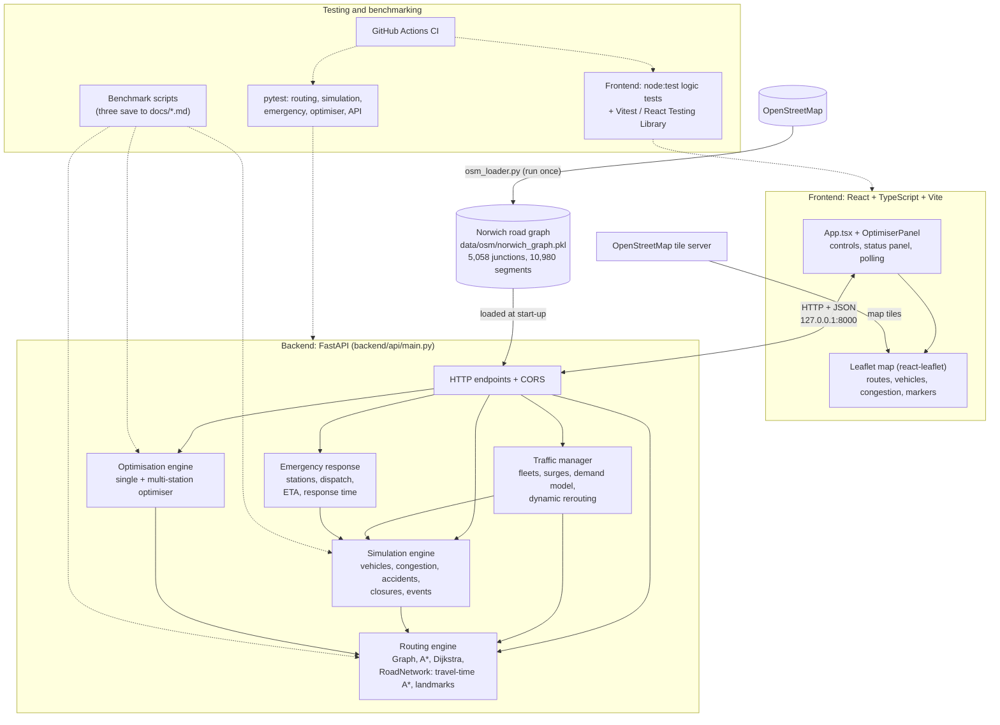

# Architecture

This document explains how NORWICH//SIM is organised, so another developer can find their way around the code. For setup and run instructions, see the [README](../README.md).

## Overview

The project has two parts that talk over HTTP:

- **Backend** (`backend/`): Python. It holds the road graph, calculates routes, runs the simulation, and exposes everything through a FastAPI app.
- **Frontend** (`frontend/`): React + TypeScript. It draws the map and calls the backend.



The Norwich data is downloaded once and saved as a pickle file. The API loads it when it starts, and the benchmark and optimiser scripts load it themselves. See [Road-network data](../README.md#road-network-data).

## Folder guide

```
backend/
├── api/
│   ├── main.py                 FastAPI app: every HTTP endpoint, CORS, logging set-up, graph loading
│   └── settings.py             Reads CORS_ORIGINS and LOG_LEVEL (no FastAPI, so testable on its own)
├── routing/
│   ├── graph.py                Graph class (nodes with lat/lon, weighted directed edges)
│   ├── osm_loader.py           Downloads the Norwich network and saves it as a pickle
│   ├── a_star.py               A* search; optional traffic penalty and blocked roads
│   ├── travel_time.py          RoadNetwork: lengths and segment keys built once, fastest-route A* (travel time),
│   │                           main connected area (Kosaraju), landmark (ALT) lower bounds
│   ├── dijkstra.py             Dijkstra search (used for comparison and benchmarking)
│   ├── benchmark.py            Dijkstra vs A* on random journeys (prints its results)
│   ├── benchmark_congestion.py Shortest-path vs congestion-aware routing (--save writes docs/congestion_benchmark.md)
│   └── routing_demo.py         Tiny standalone Dijkstra/A* demo on a 5-node graph
├── simulation/
│   ├── simulation.py           Simulation class: vehicles, time, closures, accidents, events, traffic and slowdown,
│   │                           emergencies, stations; speed_factor_on_road (the one road-speed rule)
│   ├── vehicle.py              Vehicle that follows a route (slows down when told the road is busy; real road lengths)
│   ├── accidents.py            Accident: severity -> speed and capacity factors, duration
│   ├── demand.py               DemandModel (where trips start and end) and Zone
│   ├── traffic_manager.py      TrafficManager: fleets, surges, event reactions, dynamic rerouting (ReroutePolicy)
│   ├── benchmark_traffic.py    Search comparison, fleet-size scaling, accident scenario, rerouting policies
│   │                           (--save writes docs/traffic_benchmark.md)
│   ├── rerouting.py            Finds vehicles affected by a closure and gives them new routes
│   ├── emergency.py            Emergency (location, state, response time)
│   ├── station.py              EmergencyStation (holds available emergency vehicles)
│   ├── dispatch.py             Emergency status (congestion-aware ETA), and the "close a road ahead of the ambulance" scenario
│   └── benchmark_rerouting.py  Affected-only vs recalculate-all rerouting benchmark (writes docs/rerouting_benchmark.md)
├── optimiser/
│   ├── station_optimiser.py    Ranks candidate station locations, chooses SETS of stations, baselines, explanations
│   ├── run.py                  Command-line interface for the optimiser (--stations N for a set)
│   ├── validate.py             Compares optimiser estimates with the full simulation
│   └── evaluate.py             Audit tool: compares the optimiser's pick with baselines, checks it is stable, checks multi-station choice against trying every set
└── tests/                      pytest suite (+ helpers.py with tiny test road networks)

frontend/
├── src/App.tsx                 The main interface: map, controls, simulation loop, API calls
├── src/simulationHelpers.ts    Plain functions App uses: status text, emergency text, traffic summary, route conversion
├── src/OptimiserPanel.tsx      Station optimiser controls, results area and map markers (single-station and station-set)
├── src/OptimiserResults.tsx    The optimiser's summaries, bar charts and tables (no Leaflet, so testable)
├── src/components.tsx          Shared pieces: inline icons, logo, panel and KPI card, spinner
├── src/mapStyles.ts            Colours, marker sizes and line weights used on the map (shared by the map, legend and tests)
├── src/config.ts               Backend address: VITE_API_URL at build time, else http://127.0.0.1:8000
├── src/index.css               The whole design system: colour tokens, layout, components, responsive rules
├── src/optimiser.ts            Optimiser response types, requests, error handling, number formatting
├── src/main.tsx                React entry point
├── tests/                      Logic tests (Node's test runner, `npm run test:unit`)
├── ui-tests/                   Interaction tests (Vitest + jsdom + React Testing Library, `npm run test:ui`)
│                               plus their helpers: helpers.ts, fakeLeaflet.tsx, mapState.ts, setup.ts
├── vitest.config.ts            Vitest settings for ui-tests/ (jsdom, setup file)
├── tsconfig.test.json          Compiles tests/ for Node's test runner
├── tsconfig.ui-tests.json      Type-checks ui-tests/ (Vitest does not)
└── vite.config.ts, package.json, tsconfig.json, tsconfig.app.json, tsconfig.node.json, eslint.config.js

docs/                           This file, the demo guide, saved benchmark reports (congestion, rerouting, traffic)
render.yaml, requirements-deploy.txt   Render deployment (backend web service + static frontend)
.github/workflows/tests.yml     CI: backend tests (Python 3.11 and 3.12); frontend lint, build, logic tests and interaction tests
```

## Key ideas

### The graph

`routing/graph.py` is a small custom class. Each node (junction) has a latitude and longitude, and each directed edge has a length in metres. Because OpenStreetMap roads can be one-way, a route from A to B may exist while B to A does not.

### Routing

`a_star` takes the graph, a start and a destination, and optionally `traffic` and `blocked_segments`:

- The heuristic is the great-circle distance to the destination.
- With `traffic`, each vehicle on a road adds `CONGESTION_PENALTY_METRES` (50 m) to that road's cost.
- With `blocked_segments`, those roads are skipped.
- With `return_stats=True` it also returns how many nodes it explored.

Dijkstra exists so A\* can be checked against it. Both must return the same distance without traffic.

### Road segments are identified by coordinates

A road segment is represented as a tuple of its two end points' `(latitude, longitude)` pairs, sorted so direction does not matter (`get_segment` in `a_star.py`, `segment_key` in `rerouting.py`). That is why closing a road blocks it in both directions. `rerouting.build_node_lookup` maps a coordinate pair back to its junction id, which the API builds once at start-up.

### Simulation time

`Simulation.time` goes up by 1 for every `step()`, which is one simulated second. Emergency response times use this simulated time rather than the computer's clock, so they don't depend on how fast the frontend polls. The frontend advances the simulation by repeatedly calling `POST /simulation/step`.

### Congestion and vehicle movement

Congestion is not only drawn on the map, it changes how vehicles move:

1. At the start of every `step()`, `get_traffic_density()` counts the vehicles on each road segment **once**, before anyone moves. Every vehicle sees the same snapshot, so the order of the vehicle list cannot change the result.
2. `congestion_level(count)` turns a count into a level (`clear`, `light`, `moderate`, `heavy`). The map colours roads by this level, and `SPEED_FACTORS` turns the same level into a fraction of full speed: 1.0 for clear or light (a lone vehicle is never slowed), 0.6 for moderate, 0.3 for heavy.
3. `speed_factor_on_road(count, accident)` is **the one rule for how fast a road is**: the level's factor, after an accident's lost capacity raises the effective count, times the accident's own speed factor. `Simulation.road_speed_factor(segment, count)` looks up the accident. Movement, ETAs and the travel-time router all call it.
4. `Vehicle.move(time, is_blocked, speed_factor)` takes an optional function giving the speed factor for the road it is on. Movement is time-based: it works out how long the rest of the current road takes at the reduced speed, and carries any leftover time on to the next road. Without the function a vehicle drives at full speed, as before.
5. Each vehicle keeps `journey_seconds`, a clock that runs every step until it arrives, including time stuck behind a closed road. Congestion and closures both lengthen a journey, and `/simulation/step` reports `speed_factor`, `journey_seconds` and `reroutes` per vehicle.
6. `dispatch.remaining_seconds` computes an ETA the same way, so the ETA shown in the status panel grows when the route is congested or has an accident.

One traffic count drives everything: `get_traffic_density()` keys each road by `segment_between`, which sorts the two end points, so **both directions of a road are counted together**. The same count sets vehicle speed, colours the map, and feeds both routers. Every vehicle is slowed by it, ambulances on a call included (there is no ambulance priority). Simplification: a vehicle that crosses several short roads in one second keeps using that second's snapshot.

### Real road lengths

OpenStreetMap roads curve, so a road's length is longer than the straight line between its two junctions. `Simulation.use_road_lengths(mapping)` gives every vehicle the real lengths (`RoadNetwork.length_between_points`), and `Vehicle.segment_distance` uses them for movement, map position and remaining distance. The traffic manager turns this on, so in the API vehicles drive exactly the distance the router planned (`test_planned_time_matches_the_simulated_journey_on_empty_roads`). A Simulation created on its own still measures straight lines, which keeps the older tests and tools unchanged. The bit of road from a vehicle's position to the next junction after a reroute has no OSM length and is measured as a straight line.

### Travel-time routing (`routing/travel_time.py`)

`RoadNetwork` wraps the graph once: junction positions, the length of every directed road (the shorter one where OSM has two parallel roads), each road's segment key, and lengths keyed by coordinates. `fastest_path(start, destination, speed, speed_factor, blocked_segments)` is A\* where each road costs `length / (speed x speed_factor(segment))`. Its estimate is the straight-line distance at top speed, computed on a flat projection (y = R x latitude, x = R x longitude x the smallest cos(latitude) on the map, then shrunk by 0.1%) so it is always a lower bound yet needs no trigonometry per junction. Speed factors are never above 1, so the estimate never overestimates and the result is exactly the fastest route (checked against a plain Dijkstra with random slowdowns in the tests). Unlike `a_star`, it creates its tables lazily rather than for all 5,058 junctions on every call, and each junction's roads are precomputed as (neighbour, length, segment key). On Norwich it averages 2.0 ms per congested trip (`docs/traffic_benchmark.md`).

- **Main connected area.** `main_component()` finds the largest set of junctions that can all reach each other (Kosaraju's algorithm, written iteratively). On Norwich that is 4,143 of 5,058; the rest are one-way pockets and roads cut off at the map's edge. Trips are only generated inside it.
- **Landmarks (ALT).** `use_landmarks(k)` picks k junctions far apart and runs 2k Dijkstra searches once. By the triangle inequality, `d(L, v) - d(L, u)` and `d(u, L) - d(v, L)` are lower bounds on the road distance from u to v. On Norwich this bound averages 89% of the true distance, against 74% for the straight line. Because congestion only slows roads, free-flow bounds stay valid in traffic. Used as the A\* estimate (`heuristic="landmarks"`) it explores fewer junctions but is slower in pure Python, because each estimate checks every landmark; so A\* keeps the straight line by default, and the traffic manager uses the landmark bound once per decision to skip hopeless searches (`docs/traffic_benchmark.md`).

### Accidents (`simulation/accidents.py`)

An accident is not a closure: the road stays open. Each severity sets a speed factor (minor 0.7, moderate 0.45, severe 0.2), a capacity factor (0.75, 0.5, 0.34) and a default duration (10, 20, 30 simulated minutes). Capacity works through the effective vehicle count: with half the capacity, 2 vehicles count as 4, so the road reaches "heavy" sooner (a lone vehicle is not affected by capacity, only by the speed factor). `Simulation.add_accident` replaces any accident already on that road, `clear_accident` ends one early, and `step()` clears accidents whose time is up. The congestion level reported for a road includes the lost capacity, so the map colour matches the slowdown.

### Events

`Simulation.events` records `road_closed`, `road_reopened`, `accident` and `accident_cleared` with the simulated time and the road (only real changes: closing a closed road records nothing). The simulation does not act on them; the traffic manager reads new events and decides who should re-plan, so a change has the same effect whether it came from the API, a step or a test.

### Traffic manager and dynamic rerouting (`simulation/traffic_manager.py`)

`TrafficManager(network, simulation, policy)` owns the running simulation together with the road network. `step()` runs surges, moves everyone (`Simulation.step`), reads new events, then runs a rerouting pass.

- **Costs.** A road costs `length / (speed x road_speed_factor(segment, vehicles + 1))`: the speed the vehicle would have after joining it. The vehicle counts are refreshed at the start of every planning batch (`planning_traffic`), because vehicles can change road between steps. Roads that are not free flowing are worked out once per batch (`_slow_roads`); every other road is 1.0, so a search does a dictionary lookup per road instead of re-applying the speed rules. The vehicle's own presence on its current road is not counted twice. Current route and alternative are costed the same way from the same traffic, so the comparison is fair. Closed roads cost infinity.
- **When a vehicle is checked.** Routinely once every `check_interval` seconds, staggered (vehicle i when `(time + i) % interval == 0`), and not within `cooldown_seconds` of its last switch. Urgently, ignoring both, when an event affects it: an accident or closure on its remaining route, or a reopened road or cleared accident that it had changed route to avoid (each vehicle remembers those roads in `avoided_roads`). Anyone else who might now gain finds it at their next routine check. (Two broader rules were tried first and measured on Norwich with 2,000 vehicles: "the road is roughly on the way" and an exact lower-bound test both flagged over 1,200 vehicles for one reopened central road, because in heavy traffic almost any vehicle could in theory gain, and the resulting step took over 5 s.) Urgent vehicles re-plan at the start of the next step, before anyone moves, so they react at the moment of the change. A vehicle re-checked because a road got worse takes any route that saves enough; one re-checked because a road got better only switches to a route that uses that road (other gains wait for its routine check and cooldown, otherwise an out-of-schedule check becomes a back door around the cooldown).
- **Whether it switches.** Only if the new route saves at least `min_saving_seconds` and `min_saving_fraction` of the remaining time. A vehicle part-way along a road finishes it first (the new route starts with its current position and the next junction).
- **Skipping hopeless searches.** If the remaining time minus the landmark lower bound at top speed is already below the threshold, no route could save enough, so no search is run. This removed about 27% of searches on Norwich without changing any decision.
- **Defaults** (check every 10 s, 60 s cooldown, save at least 20 s and 10%) were chosen by comparing policies on Norwich (`benchmark_traffic.py`, section 4). `smoothing_seconds` (plan with traffic averaged over time) is available but off by default, because in those comparisons it made journeys longer.
- **Closures** still go through `rerouting.reroute_affected_vehicles`, but with `route_finder=traffic.route_finder()` so they are planned with travel time too. The default search (shortest route plus 50 m per vehicle) is kept for code that calls it without a route finder.

### Demand, fleets and surges (`simulation/demand.py`)

`DemandModel.random_trip` picks an origin evenly over junctions in the main connected area, and a destination that is drawn towards the city centre with probability `centre_share` (Gaussian weight, scale 1.2 km) and otherwise even. Trips shorter than 800 m in a straight line are not made. A `Zone` (centre and radius) can restrict either end. `TrafficManager.spawn_vehicles(count)` routes each trip with travel-time A\* on the current traffic. A `Surge` adds `vehicles_per_minute` trips into (inbound) or out of (outbound) a zone each simulated second (carrying fractions over) until its duration ends. With no population data this is a plausible, explainable model, not a calibrated one.

### Rerouting

When a road closes, `rerouting.reroute_affected_vehicles` first checks which vehicles' remaining routes use that road. This check is cheap. A\* only runs for those vehicles. A vehicle in the middle of a road finishes that road first, so the new route starts at the next junction it will reach. A vehicle with no alternative keeps its route (and waits at the closure until it reopens). The rerouting benchmark compares this against recalculating every vehicle.

### Emergencies

1. `add_station` creates an `EmergencyStation`, and `add_emergency_vehicle` puts an ambulance in it.
2. `create_emergency` records an emergency at a location, and `dispatch_from_nearest_station` sends an ambulance from the nearest station that has one available. "Nearest" is measured in a straight line on latitude/longitude, not by road. If no ambulance is free the API cancels the emergency and answers 404; there is no queue.
3. The API calculates the ambulance's route with A\*, using current traffic and closures, and gives it to the vehicle.
4. When the ambulance reaches the emergency, the emergency is resolved and the response time is recorded in simulated seconds. The ambulance becomes available again.
5. `dispatch.block_road_ahead` closes a road on the ambulance's route ahead of it and reroutes it using the same rerouting code as any other vehicle. It reports the extra distance and time of the detour.

`dispatch.py` deliberately has no FastAPI code in it, so the scenario can be tested on a tiny map.

### Station optimiser

For each candidate location, `station_optimiser.py` runs one Dijkstra search to get the distance to every junction. It reuses the same random emergencies for every candidate, so the comparison is fair. Response time is distance divided by ambulance speed. This is what keeps it fast: one search per candidate rather than one per emergency.

- **Candidates.** `dense_candidates` lays a 7x7 grid over the map and moves each point to the nearest well-connected junction (one that can reach at least 90% of the network). Duplicates and points with no well-connected junction nearby are dropped, which leaves about 38 candidates for Norwich.
- **Ranking.** Candidates are ranked by average response time. An emergency a station cannot reach counts as the slowest response seen in that run. Without this rule a station cut off from most of the map averaged only the few emergencies it *could* reach and ranked first (there is a regression test for this).
- **Explanation.** `explain_best` turns the numbers into a few plain sentences (why #1 won, and whether another candidate has a better worst case). The API returns them and the frontend displays them.
- **Checking it.** `validate.py` checks the estimate against ambulances driven through the full simulation. (Its ambulance has the road to itself; a car on the same road would count as traffic and slow it down, which is exactly what the simulation is meant to do but not what that check measures.) `evaluate.py` compares the winner with baselines (city centre, middle of the map, random junctions) on the same set of junctions and re-runs the optimiser with several seeds to check the answer is stable. It only reads the optimiser, so it is safe to run at any time.

### Choosing several stations

`optimise_station_set` reuses the same ingredients as the single-station ranking (`prepare_stations` snaps and searches from each candidate once, `sample_emergencies` draws the same random emergencies) and adds:

- **A table of response times.** `response_table` gives `times[candidate][emergency]` in seconds (`math.inf` if unreachable). A set of stations answers each emergency with the fastest member, and `measure_set` turns that into the same measures as a single station: average and worst response over the emergencies reached, percentage within the target out of *all* emergencies, how many were unreached, and the ranking value with unreached emergencies counted at the slowest response seen (the same rule as before, so a set of one station gives exactly the single-station numbers).
- **Selection.** `greedy_selection` adds, one at a time, the station that lowers the ranking value the most. Greedy can get stuck (the best first station is not always part of the best pair; Norwich: 8% to 11% worse than the best possible for 2 and 3 stations), so `refine_by_swapping` then tries replacing each chosen station with each unchosen one and keeps any improvement until none is left. `order_by_contribution` finally lists the stations in the order they add value. `exhaustive_selection` tries every set; it is only practical for small sizes, so it is used by the tests and `evaluate.py` to check the heuristic, not by the API.
- **Baselines.** The best single station; the `count` stations that rank best one by one (they tend to bunch together); and the average of 100 random sets. `explain_station_set` reports honestly if a baseline does as well or better.
- **Validation.** `check_settings` rejects scenarios below 1 and a speed or target that is zero, negative, NaN or infinite. (Before, speed 0 crashed with a division by zero and NaN or a non-positive target gave nonsense.)

Simplification: each emergency is treated on its own, so a station never runs out of ambulances.

### Logging

`main.py` sets up Python's `logging` with `logging.basicConfig`, at the level given by `LOG_LEVEL` (default `INFO`; `settings.log_level` validates it and refuses unknown names). The API logs, under the logger name `backend.api.main`:

- `INFO` at start-up: which graph file was loaded and its size.
- `INFO` for each emergency dispatch: type, location, vehicle, route length, junctions on the route and nodes explored.
- `DEBUG`: where the dispatched vehicle started and the full route, point by point.

`basicConfig` does nothing if logging is already set up (pytest's `caplog` relies on this), and uvicorn's own request logs keep uvicorn's format. The command-line tools (benchmarks, the optimiser CLI and `Simulation.run`'s demo) still `print`, because printing a report to the terminal is their job.

## API endpoints

All defined in `backend/api/main.py`. FastAPI generates interactive docs at `/docs`. Endpoints that act on the simulation return 404 if no simulation has been started.

| Method | Path | Purpose |
|---|---|---|
| GET | `/` | Health check (`{"name": "NORWICH//SIM", "status": "online"}`) |
| GET | `/nearest-node?latitude&longitude` | Nearest junction to a point |
| GET | `/route?start&destination` | Shortest A\* route between two junction ids (plus 50 m per vehicle on a road). Uses the running simulation's traffic and closures if there is one. |
| POST | `/simulation/start?start&destination` | Start a simulation with a vehicle from start to destination, plus one coming back if a return route exists. Also creates the traffic manager (real road lengths, dynamic rerouting) |
| GET | `/simulation/state` | Position and progress of vehicle 0 |
| POST | `/simulation/step` | Run surges, advance one simulated second, react to events and re-plan. Returns all vehicles (position, `speed_factor` where 1.0 is free flowing, `journey_seconds`, `reroutes`), `simulation_time` and `rerouted_this_step` |
| GET | `/simulation/congestion` | Vehicle count and congestion level per road segment (the level includes any accident's lost capacity) |
| POST | `/simulation/reroute?vehicle_id` | Recalculate one vehicle's route (travel time, traffic, accidents, closures) |
| POST | `/simulation/fleet?count&seed` | Add `count` (1 to 2,000) vehicles with demand-model trips and fastest routes. Returns `spawned`, `failed`, `seconds`, `total_vehicles` |
| POST | `/incident/block?start&destination` | Close the road between two adjacent junctions and reroute affected vehicles (travel time) |
| POST | `/incident/unblock?start&destination` | Reopen a closed road; `vehicles_to_recheck` says how many vehicles will re-plan on the next step |
| POST | `/incident/accident?start&destination&severity&duration_seconds` | Start an accident (`minor`, `moderate` (default) or `severe`; duration 0 to 86,400 s, default by severity). The road stays open but slow. Returns the accident and `vehicles_to_recheck` |
| POST | `/incident/accident/clear?start&destination` | Clear an accident early (404 if there is none on that road) |
| GET | `/incidents` | `incidents`: closed roads; `accidents`: active accidents with severity, factors and time left |
| POST | `/traffic/surge?latitude&longitude&radius_metres&direction&vehicles_per_minute&duration_seconds` | Start a surge into (`inbound`) or out of (`outbound`) a zone (radius 100 to 5,000 m, up to 600 vehicles a minute, up to 7,200 s). 400 if the zone has no usable junction |
| GET | `/traffic/status` | Vehicles (all and still driving), surges, accidents, closed roads, rerouting policy and counters (searches, skipped searches, reroutes, search time) |
| POST | `/traffic/rerouting?enabled` | Turn dynamic rerouting on or off (closures still reroute) |
| POST | `/station/create?latitude&longitude&station_type` | Add an emergency station |
| POST | `/station/add-vehicle?station_id&speed&vehicle_type` | Add an emergency vehicle to a station (`speed` must be above 0, otherwise 400) |
| POST | `/emergency/create?latitude&longitude&emergency_type` | Create an emergency and dispatch the nearest available vehicle |
| GET | `/emergency/status` | State, ETA, response time and reroutes for every emergency |
| POST | `/emergency/block-ahead` | Close a road ahead of the ambulance and reroute it |
| GET | `/optimiser/stations?candidates&scenarios&seed&target_seconds&speed` | Rank candidate station locations. `candidates` is optional (2 to 20 points written as `lat,lon;lat,lon`); leave it out to use the default spread of about 38 locations. Returns the ranked results and a plain-English explanation of the winner. 400 for bad candidates, `scenarios` outside 1 to 5000, or a `speed` or `target_seconds` that is not above 0 |
| GET | `/optimiser/station-set?stations&candidates&scenarios&seed&target_seconds&speed` | Choose `stations` (1 to 10, default 3) stations that work well together. Same options as above. Returns the chosen stations in pick order, the set's average, worst case, coverage within the target and unreachable count, three baselines, and a plain-English explanation. 400 if more stations are asked for than there are distinct candidate junctions |

## Frontend

The frontend is mostly one React component file, `frontend/src/App.tsx`, using `react-leaflet` for the map. The station optimiser panel and its map markers live in `frontend/src/OptimiserPanel.tsx`; the result tables are in `OptimiserResults.tsx` and the requests and types in `optimiser.ts`. Logic that does not need React (status messages, traffic summary, route conversion) lives in `simulationHelpers.ts`. It calls the backend at the address in `config.ts` (the `VITE_API_URL` build setting, defaulting to `http://127.0.0.1:8000` for local development), converts chosen map locations (latitude/longitude) into junction ids with `/nearest-node`, and runs the simulation by stepping the backend and re-drawing vehicles and congestion. It also polls `/emergency/status`. By default the backend's CORS setting only allows the origin `http://localhost:5173`; `CORS_ORIGINS` changes that (see `backend/api/settings.py`).

## Interface design

The screen is one workspace: a fixed navy header, a controls column on the left, and on the right a five-metric strip, the Norwich map (the largest element), and an analysis area for optimiser results. On narrow screens it becomes a single column in the order metrics, map, controls, results.

- **Design system.** `index.css` defines colour, type-scale, control-height, radius and elevation tokens as CSS variables (navy and slate for structure, a muted teal for positive/optimal results, amber and red only for warnings and emergencies) and the components built from them (panels, buttons, selects, the metrics strip, badges, notices, tables, bar charts). Hierarchy comes from surface contrast and spacing rather than outlines: the controls column is one surface split by hairlines, the metrics are one strip, and borders are kept for places that need them (secondary buttons, table rules). Buttons come in four variants (primary, secondary, destructive, quiet) with one shared disabled style. There are no UI or icon libraries: icons are inline SVG (`components.tsx`) and the charts are plain HTML bars.
- **Map.** The OpenStreetMap tiles are desaturated with a CSS filter so routes, congestion and markers stand out. Map colours, marker sizes and line weights live in `mapStyles.ts`: point markers share a white keyline, congestion is drawn as a wide translucent band under the thinner route line, and closures are the widest line. The toolbar shows what the next map click will do, the legend lists congestion plus only the layers currently on the map, and the latest action's message floats over the map instead of moving the layout.
- **Meaning of colour.** Route = blue, reroute (diversion) = violet so it cannot be confused with amber congestion, ambulance and emergency = red, closed road = near-black, best/optimal = green, chosen station set = navy. Congestion uses green, amber and red.
- **Accessibility.** Every group of controls is a named region, the header navigation and a skip link work with the keyboard, the simulation state is announced as a status, charts are written out as text beside each bar, the metric cards have a plain-sentence version for screen readers, and animations are switched off for people who ask for reduced motion.
- **What did not change.** All logic, requests and button labels are as before; the redesign only changed markup and styling (plus a loading spinner and disabled state on the button that was just clicked).

## Testing

**Backend.** Tests live in `backend/tests/` and use tiny hand-built graphs from `helpers.py`, so they run in a few seconds without the Norwich data. Files by area: `test_routing`, `test_road_closures`, `test_rerouting`, `test_emergency`, `test_emergency_response`, `test_edge_cases`, `test_station_optimiser`, `test_multi_station`, `test_congestion_movement`, `test_benchmark_congestion`, `test_settings` (`CORS_ORIGINS` and `LOG_LEVEL` parsing), `test_deployment_files` (`render.yaml` and the deploy requirements; the `render.yaml` checks need `pyyaml` and are skipped without it), `test_travel_time` (fastest-route A\* against a reference Dijkstra with random slowdowns, landmark bounds, main connected area), `test_accidents` (speed and capacity, expiry, ETA, real road lengths), `test_traffic_manager` (event-driven and routine rerouting, thresholds, cooldown, damping against an undamped policy, planned vs driven time, fleets, surges, demand) and `test_api` (including every Stage 2 endpoint). `helpers.make_grid_graph` builds a seeded grid map for the larger scenarios.

`test_api.py` drives the real FastAPI app through `TestClient`. `main.py` reads the `NORWICH_SIM_GRAPH` environment variable (default: the Norwich pickle), and the test file points it at a small 4x4 grid map with a one-way dead end and an unconnected junction, so the endpoints are tested without the Norwich data. The file is skipped if `fastapi` or `httpx` is not installed. The simulation is a module-level variable in `main.py`, so a fixture resets it before every test.

**Frontend logic tests.** `frontend/tests/` holds tests run by `npm run test:unit`. They use Node's built-in test runner: `tsconfig.test.json` compiles the tests and the few source files they import (`simulationHelpers.ts`, `optimiser.ts`, `OptimiserResults.tsx`) into `.test-build/`, then `node --test` runs them. Components are rendered to HTML with `react-dom/server`; `fetch` is replaced by a fake. Source files that tests import must write their relative imports with the extension (`./optimiser.ts`).

**Frontend interaction tests.** `frontend/ui-tests/` holds tests run by `npm run test:ui` (Vitest, configured in `vitest.config.ts`, with jsdom and React Testing Library). They render the whole `App` and click through it. Three things are replaced: `fetch` (`helpers.ts` provides a fake backend where each test says what each endpoint answers, and records every request), `react-leaflet` (`fakeLeaflet.tsx` turns map objects into plain elements with `data-*` attributes, and `mapState.ts` lets a test "click the map"), and the app's one-second polling timer (`controlPolling` lets a test deliver exactly one simulation update at a time; other timers, such as Testing Library's own, run normally). `setup.ts` unmounts the app and undoes every fake after each test. The marker sizes the tests look for (`POINT`, `VEHICLE`, `EMERGENCY_SPOT`, ...) are read from `mapStyles.ts`, so a design change to sizes does not break them. `npm run test:ui` type-checks the tests with `tsconfig.ui-tests.json` first, because Vitest does not check types. Files: `simulation.test.tsx` (route, simulation, start over, failures, road closure), `emergency.test.tsx` (ambulance dispatch, progress, close road ahead, failures), `optimiser.test.tsx` (ranking, station set, loading, clearing, failures), `layout.test.tsx` (page structure and landmarks, navigation, empty states, route steps, metric cards, the busy state of Calculate Route). Real Leaflet and real browser layout are not covered.

`npm test` runs both kinds (`test:unit`, then `test:ui`).

GitHub Actions runs `python -m pytest backend/tests -v` on Python 3.11 and 3.12 (with `pytest fastapi httpx pyyaml` installed), and for the frontend `npm run lint`, `npm run build`, `npm run test:unit` and `npm run test:ui` as separate steps.

## Known design trade-offs

- The simulation is a module-level variable in `main.py`, which keeps the code simple but means one simulation per server process.
- The pickle format is quick to load but couples the data file to the `Graph` class and is not safe to load from untrusted sources.
- `frontend/src/App.tsx` holds all the UI logic in one file. Splitting it into components and a small API client would be a natural clean-up.
- The frontend has no pause or reset button: a simulation starts when a route is calculated and a new map click starts over.
- Two routers exist side by side: `a_star` (shortest distance plus 50 m per vehicle), used by `/route`, emergency dispatch, the closure rerouting default and the older benchmarks; and `RoadNetwork.fastest_path` (travel time), used by everything the traffic manager does. Moving the remaining callers to travel time would change their tested results, so it was left for a later stage.
- `Simulation` stays independent of the road graph (its tests build it from a list of points); everything that needs the graph lives in `TrafficManager`. The API creates both together.
- Vehicles are never removed from the list, because the API uses list positions as vehicle ids. Rerouting and stepping skip finished vehicles, but the `/simulation/step` response grows with every vehicle ever added.
- A vehicle rerouted part-way along a road gets a route that starts at its current position (`rerouting.find_restart_point`, pinned by `test_rerouting.py`). Until it reaches the next junction its road segment is keyed by that point, so for those seconds it is not counted in the real road's traffic and an accident on the real road does not slow it. Fixing this means keeping the real road's identity on the vehicle (or changing that test's expectation), left for a later stage.
- Urgent re-plans are done all in one step, so an event affecting a few hundred vehicles makes that step slow (about 1 to 1.6 s with 2,000 vehicles on Norwich). Spreading them over a few steps would trade that for a slower reaction.
- The speed rule is a step function of the vehicle count, so costs jump when one vehicle joins a road. It is kept from Stage 1 (existing tests pin its values); a smooth, length-aware function would make re-planning steadier.
- **Deployment (Render).** `render.yaml` describes a free Python web service (the backend, started with `uvicorn ... --port $PORT`) and a static site (the frontend, built with `npm run build`). The frontend learns the backend's address from `VITE_API_URL` at build time (`frontend/src/config.ts`), and the backend allows only the origins listed in `CORS_ORIGINS` (`backend/api/settings.py`). The Norwich graph is committed to Git so the backend can start without downloading anything. Because the simulation lives in one in-memory variable, a deployed instance is shared by everyone who uses it.
