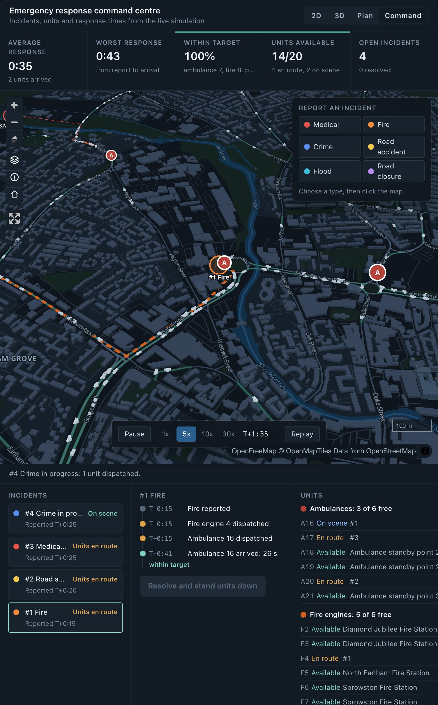
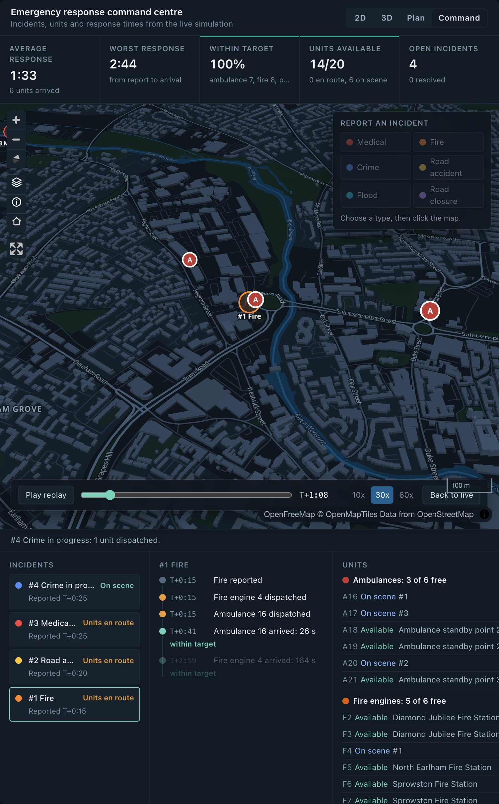

# Emergency response command centre

The map's **Command** view is an operations room built on the live
simulation. You report incidents by clicking the 3D map. The backend sends
units by road travel time, and they drive through the simulated traffic and
re-plan around closures and congestion. Each incident keeps a timeline from
report to resolution, the response figures update as units arrive, and
everything the units did can be replayed.

| Where | What |
|---|---|
| `backend/simulation/command.py` | Incidents, response plans, time at the scene, timelines, metrics and recorded tracks. No FastAPI, so it is tested on a small grid. |
| `backend/api/routes/command.py` | `POST /command/start`, and per run `/command`, `/command/fleet`, `/command/incidents`, `/command/incidents/{id}/resolve` and `/command/replay`. |
| `frontend/src/command.ts` | The map's features, replay interpolation, incident status over time and the figures. |
| `frontend/src/CommandCentre.tsx` | The workspace: figures, map, report panel, playback or replay, incidents, timeline and units. |
| `frontend/src/CommandMap2D.tsx` | The same features on a Leaflet map, used when the 3D map cannot start. |

## What it reuses

The command centre adds very little simulation code of its own. Every unit
sent is an ordinary `Emergency` handled by the existing code:

- **Dispatch** (`dispatch.py`): the free unit of the service that would
  arrive first by road, under the traffic, accidents and closures now. When
  no unit is free, the unit request waits in a queue and is answered oldest
  first. When no station can reach the place at all, it is refused.
- **Driving and rerouting:** units move in the simulation like every
  vehicle, with right of way and without speed limits (`services.py`). They
  re-plan at once when a closure or accident affects their route, and every
  10 s if a meaningfully faster route appears (`traffic_manager.py`). The
  timeline and the units table show how many times each unit changed route.
- **Accidents, floods and closures** are made with the simulation's own
  methods (`add_accident`, `add_flood`, `block_segment`), so every vehicle
  reacts to them as it does elsewhere.
- **The database** records each unit dispatched, queued, refused or arrived
  through the same recorder as `/emergency/create`, plus stations, vehicles,
  closures and accidents. A run's history (`/simulations/{id}/history`)
  includes the command centre's activity after the run ends.
- **The 3D map** is the same `Map3D` component as the traffic view. It gained
  an optional camera `focus`, per-feature route colours and point labels.
  Other views are unaffected.

## The fleet

`POST /command/start` starts a new run with the `osm` traffic model, which
enables the realistic emergency rules: the queue, units driving back to their
station, and right of way. The new run does not replace anyone's default
run. It places 1 to 4 units (2 by default) at each station:

- **Fire:** Norwich's 3 fire stations, from OpenStreetMap.
- **Police:** Norwich's 4 police stations, from OpenStreetMap.
- **Ambulance:** OpenStreetMap maps no road ambulance station in Norwich, so
  ambulances wait at **3 standby points chosen by the station optimiser**.
  These are labelled as optimised sites on the map and in the station
  popups, not presented as real stations.

It also adds ordinary traffic (800 vehicles by default) from the demand
model, so the units drive through real congestion.

## Incidents and response plans

| Incident | Units sent | Effect on the roads | Time at the scene |
|---|---|---|---|
| Medical | ambulance | none | 15 min |
| Fire | fire engine, ambulance | none | 20 min |
| Crime | police car | none | 10 min |
| Road accident | ambulance, police car | a severe accident on the nearest road (open but slow, for its usual time) | 15 min |
| Flood | fire engine | every road within 200 m closed for 20 min, then recovering over 10 min | 20 min |
| Road closure | none | the nearest road closed until the operator reopens it | none |

The response plans and on-scene times are **model settings chosen for this
simulation**, set out in `command.py`. They are not the mobilisation rules of
any real service.

A flood's centre is often cut off by its own water. The fire engine is
therefore sent to the nearest junction that no flooded road touches and that
a fire station can still reach by road.

## An incident's life

- **Reported:** the time of the click, in simulated seconds.
- **Dispatched:** when each unit was sent. If none was free, the timeline
  says how long the request waited.
- **Arrived:** when each unit reached the scene. **Response time is arrival
  minus report time**, so queueing counts, as in the rest of the simulation.
  Each arrival is marked within or outside its service's target: ambulance
  7 min, fire 8 min, police 15 min (`services.py`).
- **Left the scene:** after the kind's on-scene time. The unit then drives
  back to its station and can be sent to another incident on the way.
- **Road cleared:** when the accident expired, the flood receded or the
  closure was reopened.
- **Resolved:** when every unit has left the scene and the road is clear.

An operator can resolve an incident early with **Resolve and stand units
down**. Units at the scene leave at once, and any accident, flood or closure
ends. Resolving is refused while a unit is still on its way or waiting: the
unit would otherwise be stranded with nowhere to go. A road closure stays
until the operator reopens it.

To support this, `Emergency` gained an on-scene time. It defaults to 0,
which frees the vehicle the moment it arrives, so every other part of the
simulation behaves exactly as before.

## Figures

All figures cover the units that have arrived:

- mean and worst response time;
- the share within their service's target;
- units available (at a station or driving back), en route, on scene and
  queued;
- open and resolved incidents;
- the same per service in the API (`metrics.by_service`).

## Replay

While the command centre runs, each unit's position is recorded every
simulated second while it is out: on its way, at the scene or driving back.
Standing still is stored as its first and latest sample only. **Replay**
pauses the live run and plays this recording on the map:

- units are drawn at their recorded positions, interpolated between samples;
- incidents appear and disappear at their reported and resolved times;
- the selected incident's timeline greys out events that have not happened
  yet at the time shown.

**Limitation:** the tracks are kept **in memory** with the live run (at most
about 3 hours a unit). They are not saved to PostgreSQL, so an ended run can
be replayed only as its saved history (dispatch, arrival and response times
per emergency, closures, accidents and events), not as moving units. Saving
tracks would need a new table and migration, and has not been done.

## 2D fallback

If the 3D map cannot start (no WebGL), the command centre switches to a
Leaflet map that draws the same incidents, routes, units and stations. Every
panel keeps working, and a notice says why. The rest of the site's 2D and 3D
views are unchanged.

## What this does not claim

- Response times are those of this simulation: the road graph, its speed
  limits, the simulated traffic, and fixed vehicle speeds with right of way.
  They are **not predictions of real emergency response times** in Norwich.
- The model has no call handling, crew turn-out time or pre-alerts, so real
  times would be longer.
- The ambulance standby points come from the optimiser, not from the
  ambulance service.
- Units are sent strictly by the response plan. There is no triage, priority
  between incidents or cross-border cover.

## Tests

- `backend/tests/test_command.py` (15 tests on a small grid) covers:
  - time at the scene, and that the previous behaviour is unchanged without
    it;
  - the unit sent is the one with the shortest drive;
  - refused services;
  - simultaneous incidents queueing for one ambulance;
  - closures held until reopened;
  - accidents resolving only once the road is clear;
  - operator resolution and its refusal while a unit is on its way;
  - flood staging;
  - rerouting round a road closed ahead;
  - timeline order and times;
  - metrics;
  - tracks: once a second, starting at the station, with no jumps longer
    than the unit could drive, and a stop stored as two samples;
  - the state description.
- `backend/tests/test_api.py` (3 tests) covers the endpoints, their
  validation, and adding a fleet to an ordinary run.
- `backend/tests/db/test_api_persistence.py` checks that command centre
  units, stations and closures are saved to PostgreSQL with the same
  response times.
- `frontend/tests/command.test.ts` covers replay interpolation and heading,
  incident status over time, the map's features (live and replay), and the
  figures.
- `frontend/ui-tests/command.test.tsx` uses a stand-in 3D map and covers:
  starting, reporting by clicking, routes, the camera, the timeline and
  figures, resolving, replay, the 2D fallback and errors.
- `frontend/e2e/command.spec.ts` uses the real map and backend: three
  simultaneous incidents, units and routes drawn, arrival with its
  response time, reopening a road, and replay.
