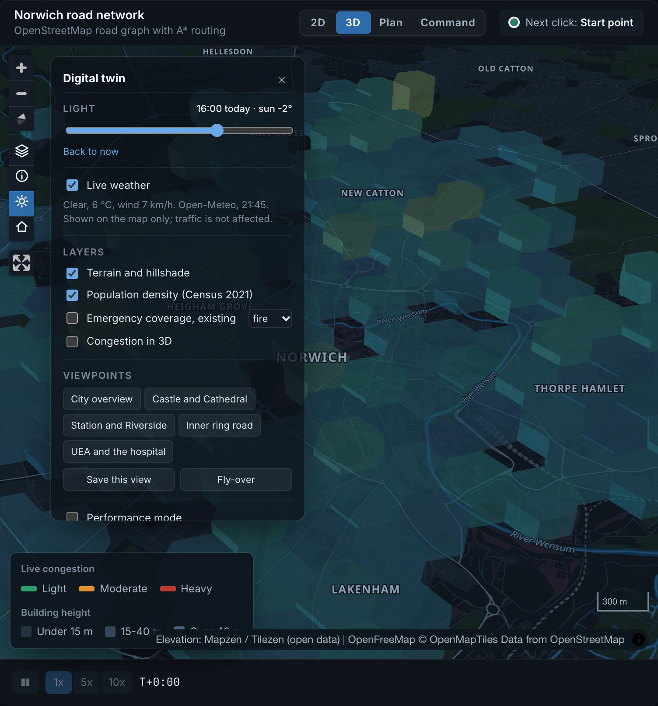
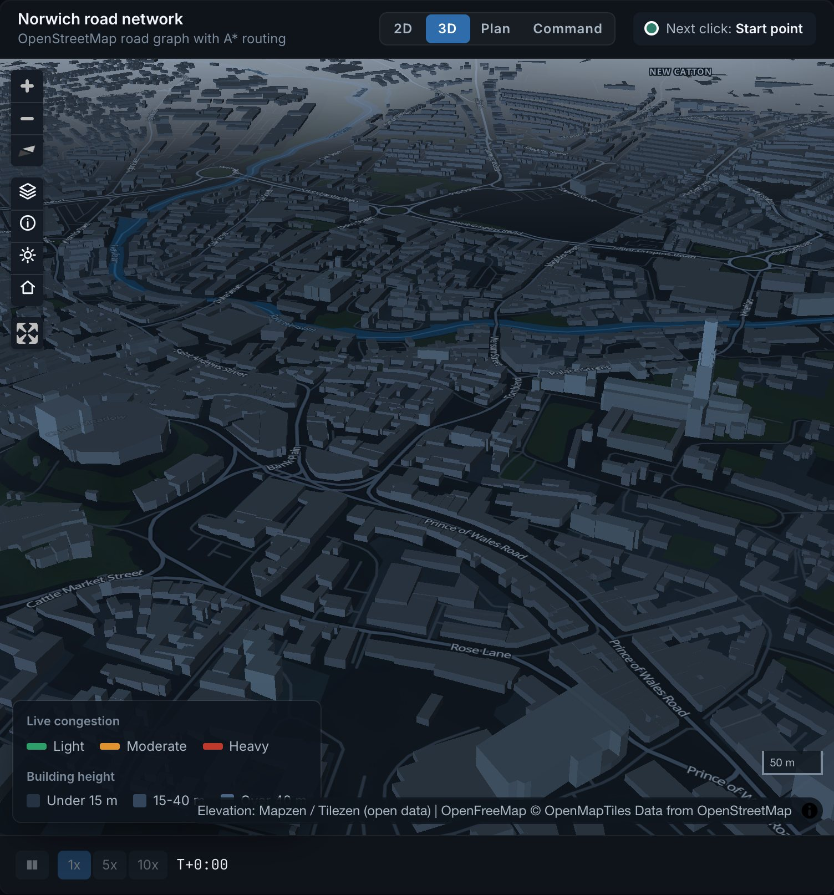

# The 3D digital twin

The 3D map (and the command centre's map) has a **Digital twin** panel: the
sun-icon button among the map tools. Everything it adds stays grounded in
Norwich and in real data.

| Feature | Source | Notes |
|---|---|---|
| **Light** | Sun position computed for Norwich (52.63° N, 1.29° E) with the NOAA solar equations, now or at any hour today (UK time) | Drives MapLibre's light direction, colour and intensity, and the sky. Tested against the solstice and equinox altitudes and azimuths. |
| **Weather** | Open-Meteo's current reading for Norwich, via `GET /city/weather` (cached for 10 minutes; 503 when unreachable) | Clouds and visibility tint and haze the sky; rain and snow are drawn as falling streaks, as heavy as the reading. **Shown on the map only: the traffic model does not change with the weather.** |
| **Terrain and hillshade** | Mapzen / Tilezen open elevation tiles (Terrarium encoding) on AWS | Exaggerated 1.8×, since Norwich only rises from about 0 to 40 m. Opt-in and remembered, because it costs every frame. |
| **Population density** | The census weights the backend uses everywhere (Census 2021, 471 output areas, spread over junctions), per 180 m hexagon | On a square-root scale, so the suburbs are not flattened by the densest cells. |
| **Emergency coverage** | The planning view's road-network response time from OpenStreetMap's fire or police stations | Drawn at a quarter of the planning view's heights, so streets stay visible. Red outlines mark hexagons with 50+ residents beyond the target. |
| **Congestion in 3D** | The live simulation's congestion | An 8 m wall along each road with 2+ vehicles, as tall as its traffic (6 m a vehicle, capped at 220 m). |
| **Viewpoints and fly-over** | Five real places (city overview, castle and cathedral, station and riverside, inner ring road, UEA and the hospital) and your own saved views | The fly-over tours the viewpoints; a click or touch stops it. |
| **Performance mode** | Switched on automatically when WebGL is drawn in software (no GPU), with 4 cores or fewer, 4 GB of memory or less, reduced motion, or more than 3,000 vehicles | Standard resolution (pixel ratio 1), no terrain, no rain or snow. |

## What was not changed, and why

- **Buildings** already come from OpenStreetMap through OpenFreeMap's
  tiles, with their mapped heights and base heights (`render_height`,
  `render_min_height`). No better open building data for Norwich was
  available to add. Roof shapes and facades are not in the tiles.
- **Vehicle turning and junction behaviour** are unchanged. Vehicles
  already glide along the real road shapes and turn by the shortest angle
  ([OPERATIONS_VIEW.md](OPERATIONS_VIEW.md)).
- **Playback:** the live simulation keeps its timeline with pause and 1x,
  5x or 10x speeds. Replay of recorded movement exists in the command
  centre ([COMMAND_CENTRE.md](COMMAND_CENTRE.md)). The route simulation
  records only per-step summaries, so it cannot replay movement.

## Tests

- `frontend/tests/twin.test.ts` covers:
  - the sun at the solstices and equinoxes;
  - light and sky by day, at night and under cloud;
  - the weather's effect;
  - the population, coverage and congestion layers;
  - performance-mode detection, including software renderers;
  - the layer manager on a stand-in map (create, terrain on and off, show
    and hide, sky and light, removal).
- `frontend/e2e/map3d.spec.ts` uses the real map:
  - the sky changes with the time of day;
  - the weather is read from the backend;
  - population hexagons are drawn;
  - a viewpoint moves the camera;
  - terrain switches on and off, and performance mode lowers the
    resolution.
- `backend/tests/test_api.py` covers the weather reading, the 503 when
  Open-Meteo is unreachable, and keeping the last reading.
