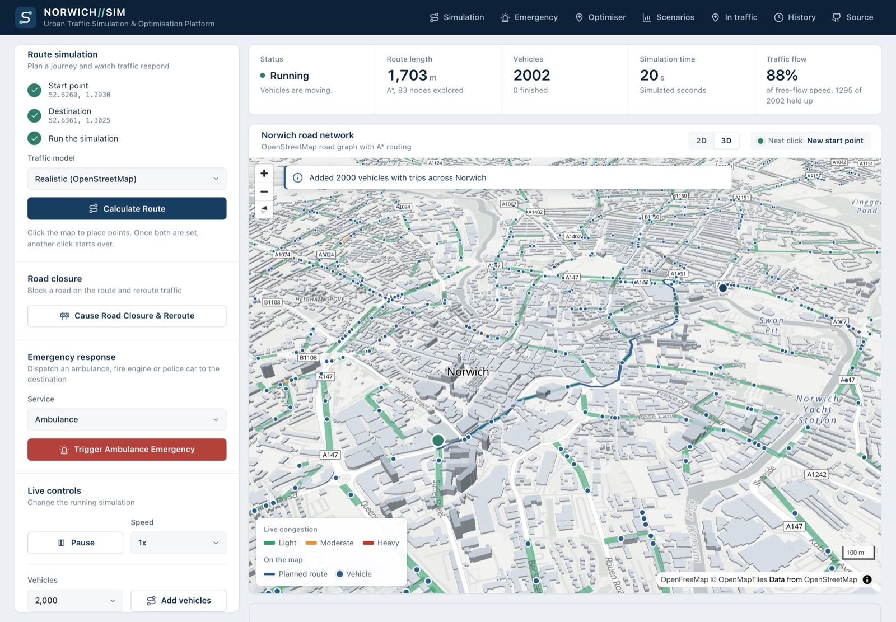
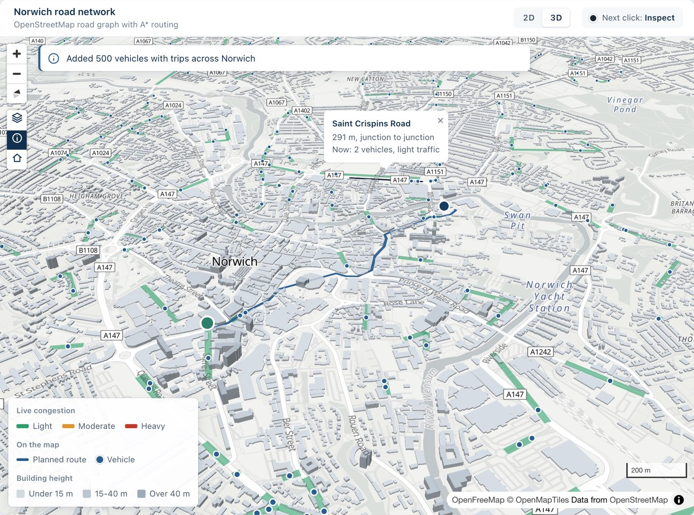

# 3D map prototype: evaluation

An experimental 3D map (branch `experiment-3d-map`), built to decide whether the Norwich Urban Traffic Simulator should move from its 2D Leaflet map to MapLibre GL. The 2D map is unchanged and stays the default; a **2D / 3D** switch in the map's toolbar chooses between them, and the choice is remembered in the browser.

## What it does

- **Basemap.** OpenFreeMap's *Positron* style (vector tiles from OpenStreetMap), with Norwich's buildings extruded to their mapped heights. The camera starts tilted at 55 degrees over the city centre; drag to pan, right-drag (or the compass) to rotate and tilt, scroll to zoom.
- **Simulation layers.** Everything the 2D map draws, from the same app state: the planned route, the diversion after a closure, emergency routes, closed roads, live congestion, scenario hotspots and closures, start and destination, the emergency's location, optimiser candidates and chosen stations (numbered, with the same popup figures), and every vehicle. Nothing is invented: [`src/mapData.ts`](../frontend/src/mapData.ts) turns the state into GeoJSON, one source per kind of thing.
- **Emergency vehicles** have their own markers: a larger circle in the service's colour with its letter (A ambulance, F fire engine, P police).
- **Clicks** on the 3D map plan routes and pick roads exactly as on the 2D map; clicking a station marker shows its figures instead.
- **Fallback.** If the browser cannot start WebGL, the app switches back to 2D and says why.

## Tools on the 3D map

Three buttons sit under the zoom and compass controls:

- **Layers** switches groups of layers on and off: 3D buildings, live congestion, vehicles, routes and closures, and stations and scenario results. The choice is remembered in the browser.
- **Inspect** makes clicks describe what is there instead of placing route points (the toolbar's "Next click" says *Inspect*):
  - a **vehicle**: its number, type, whether it is answering an emergency, how held up it is (the backend's speed factor) and its journey time so far;
  - a **building**: its height, and a note when the height is 5 m, the value OpenMapTiles uses when none is mapped;
  - a **road**: the simulation's own road (the existing `/scenarios/nearest-road` endpoint), its name, its length between junctions and its live traffic from the congestion layer. The road is outlined on the map.
  
  A road the simulation is drawing (traffic, a route or a closure) takes priority over a building standing in front of it. Picking a road for a scenario or live incident overrides Inspect.
- **Reset view** returns the camera to the starting view over the city centre.

The camera also moves on its own, framing a newly planned route, a new emergency (the vehicle's route and the incident) or a new set of optimiser stations, while keeping the current tilt and rotation. A diversion or an ambulance re-planning around a closure does not move it, so the camera never jumps mid-run. The moves are animated unless the visitor's system asks for reduced motion, which MapLibre respects.

The legend gains a building-height key in 3D, and shows each emergency service as it is drawn: a badge in its colour with its letter.

On a phone (390 x 844), the toolbar wraps onto two lines, MapLibre's credit line starts folded into its "i" button so it does not cover the legend, and the scale bar is hidden. Popups sit above the message banner, and the map's buttons sit above the popups.

## How it fits in

- [`Map3D.tsx`](../frontend/src/Map3D.tsx) is loaded with `React.lazy`, so MapLibre (about 1 MB, 274 kB compressed) downloads only when someone picks 3D. The main bundle is unchanged in practice (461 kB, 136 kB compressed).
- The app rebuilds each GeoJSON source only when its own inputs change (`useMemo` per source), and the map re-sends only the sources that changed, so a simulation tick re-sends vehicles and congestion, not routes or stations.
- One new dependency: `maplibre-gl` (BSD-3-Clause). No API keys: OpenFreeMap needs none, so there is no secret in the frontend.

## Performance

Production build (`vite build` + `vite preview`) against the real backend, 2,000 vehicles plus the route's vehicle driving, central Norwich in view, 1440 x 1000 at 2x pixel density, Chromium on an M1 MacBook Air using its GPU (Metal), Low Power Mode off. Measured over 10 seconds of the simulation running at one update a second.

| | 2D (Leaflet) | 3D (MapLibre) |
|---|---|---|
| Frames per second | 60 | 60 |
| Worst frame | 33 ms | 17 ms |
| Main-thread long tasks | none recorded | none recorded |
| JavaScript heap | 57 MB | 45 MB |
| Map ready after page load | 0.2 s | 2.0 s |
| Map data on first load (tiles, style, fonts) | 383 KB, 15 requests | 1.8 MB, 14 requests |
| Website code (uncompressed) | 488 KB | 1.6 MB |

- 3D draws vehicles on the GPU as one layer; 2D draws each as an SVG element (about 2,900 at this load), which is why its worst frame is longer.
- The heap figure excludes GPU memory, which MapLibre uses for tiles and buildings; it is released when the 3D map is closed (`map.remove()`).
- In headless Chromium without a GPU (software rendering, as in CI) the 3D map still works: the end-to-end test passes in about 9 seconds.
- The figures above were measured before the tools were added. The tools add no work per frame (they run only on a click or when a route, emergency or set of stations changes), so they were not re-measured.
- The browser console shows three "Expected value to be of type number" warnings when the map loads. They come from OpenFreeMap's Positron style itself: a page with only that style and none of the app's layers shows the same three.
- Not measured: phones and low-end laptops, and frame rates while moving the camera (an automated orbit could not be confirmed to have rotated the map).

## Building height data

OpenFreeMap's heights come from OpenStreetMap: `height`, else `building:levels` x 3.66 m, else a default of about 5 m. Counted with the Overpass API on 18 November 2026:

| Area | Buildings | With a height or floor count |
|---|---|---|
| Central Norwich (52.624–52.636 N, 1.286–1.306 E) | 2,429 | 304 (13%) |
| Wider city (52.615–52.645 N, 1.270–1.320 E) | 17,699 | 4,279 (24%) |

So most buildings are drawn at the default height; a few mapped ones stand out (Westlegate Tower 41 m, Pablo Fanque House 46 m, The Forum 15 m). The skyline is an approximation, and landmarks such as the cathedral spire are not shown at their real height. Better heights would need another source, such as the Environment Agency's open LiDAR surface models (building height = surface minus terrain), which is a data-processing project of its own.

## Tile providers

| Option | Cost and limits | Keys | 3D buildings | Notes |
|---|---|---|---|---|
| **OpenFreeMap** (used) | Free; its site states no limits on map views or requests | None | Yes (OpenMapTiles heights) | Funded by donations, no SLA. Attribution required; MapLibre adds it automatically. |
| OpenStreetMap raster tiles (the 2D map) | Free under OSM's tile usage policy | None | No | Raster images; cannot extrude buildings. |
| MapTiler, Stadia Maps and similar | Free tiers with monthly limits, then paid | Key in the browser, restricted by domain | Yes | Support and an SLA, at a cost once traffic grows. |
| Self-hosted PMTiles extract of Norfolk | Hosting only (a static file on Render) | None | Yes | No third-party dependency; needs the `pmtiles` package and an extract made with the PMTiles tool. The best long-term option if OpenFreeMap became unreliable. |

## Limitations

1. **Building heights** are mostly estimated (above).
2. **First load is heavier**: about 2 s to a ready map and about 2.5 MB more downloaded than 2D (1.4 MB of map data, 1.1 MB of code). Fine on broadband; slower on mobile data.
3. **Vehicles jump** once a second, as on the 2D map (positions come from the backend each tick). Smooth movement would interpolate between ticks on the client.
4. **Routes are drawn on the ground**, so a building in front of a road hides that part of it, as it would in reality. Lowering the tilt or rotating shows it.
5. **Depends on OpenFreeMap's public servers**, with no SLA (self-hosting is the fallback).
6. **No real phone tested yet.** The layout was checked in Chromium at phone size (390 x 844), but not on a real device, and touch gestures (two-finger tilt and rotate) were not tried.
7. **Inspecting a road** names the simulation's nearest road. On a traffic segment the lookup is checked against that segment; if they differ, the popup gives the segment's live traffic without a name rather than describe the wrong road.
8. **Building inspection** reports OpenMapTiles' height, so most buildings show the 5 m default (see building height data above).

## Verdict

The 3D map is a working, data-driven replacement for the 2D map: it draws the same simulation from the same state, keeps 60 frames a second with 2,000 vehicles on an M1, and needs no API key or new backend work. It looks markedly more professional. Its costs are a heavier first load and approximate building heights.

With the tools above (layers, inspection, camera moves, reset view and a 3D legend), it is also easier to demonstrate than the 2D map.

Recommendation: keep 2D as the default until the 3D map has been tried on a real phone and a slower laptop; then make 3D the default with 2D as the fallback. Smooth vehicle movement between updates is the next visible improvement.

## Tests

- `frontend/tests/mapData.test.ts`: the GeoJSON built from the app's state (coordinates, vehicles, service markers, routes, closures, stations), and what Inspect says about vehicles, buildings and roads.
- `frontend/ui-tests/mapView.test.tsx`: the switch, remembering the choice, clicks on the 3D map, Inspect in the toolbar, the building-height legend, and the fallback to 2D (with a stand-in for MapLibre, which jsdom cannot run).
- `frontend/e2e/map3d.spec.ts`: the real 3D map in Chromium against the real backend: buildings drawn, a route planned by clicking the 3D map and the camera framing it, 500 vehicles, congestion, buildings switched off and on from Layers, a road inspected with its live traffic, an ambulance and its route drawn, Reset view, and switching back to 2D. It passed four runs in a row.
