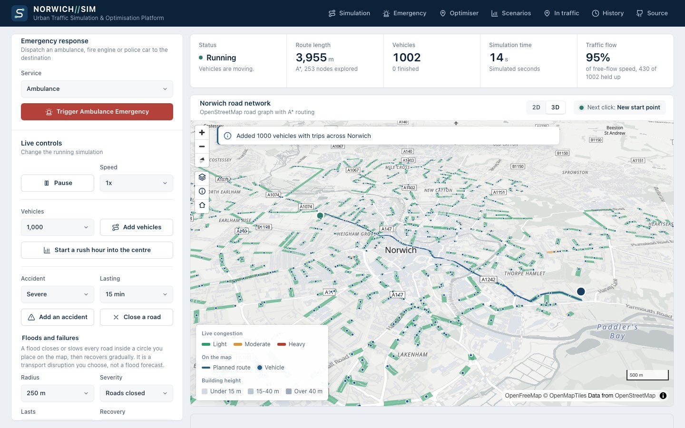
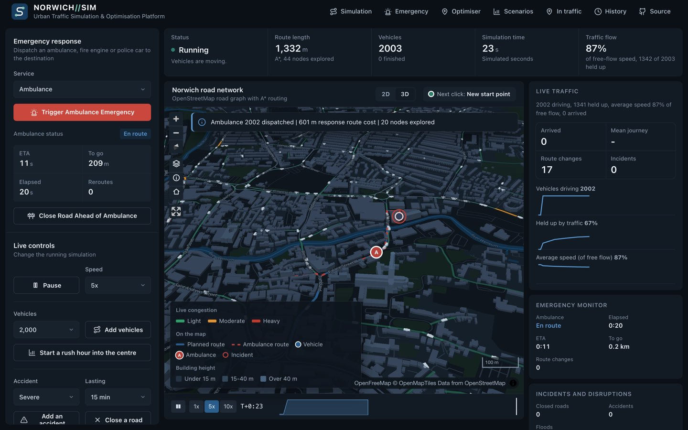
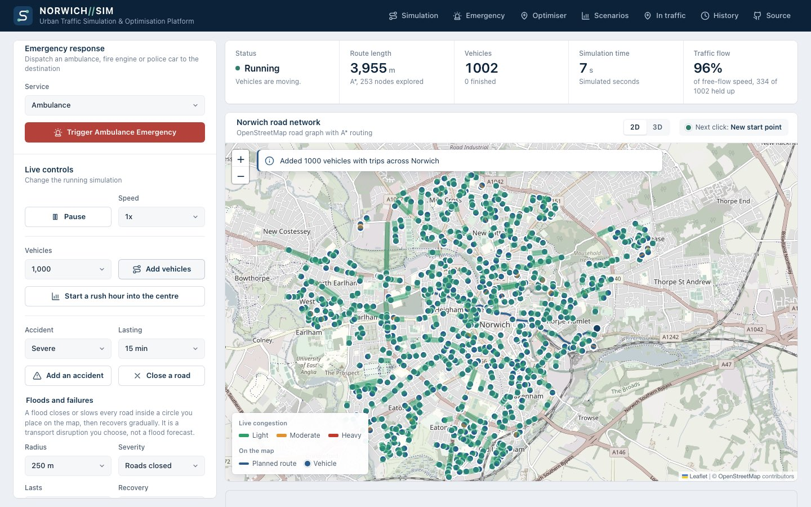
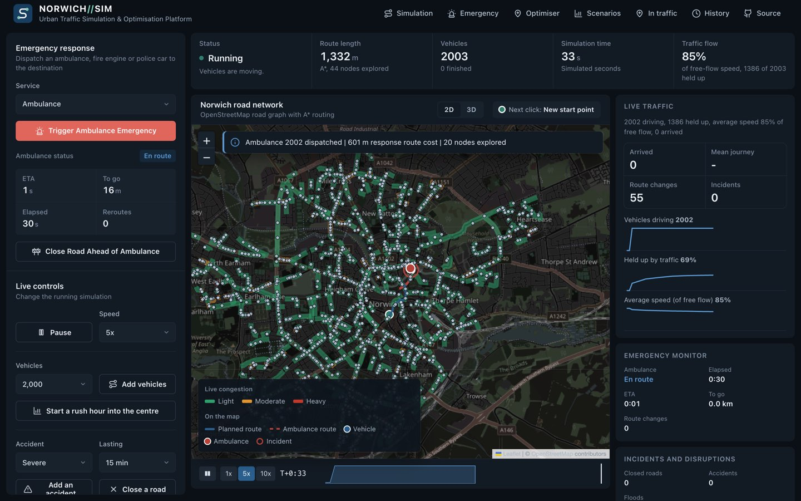
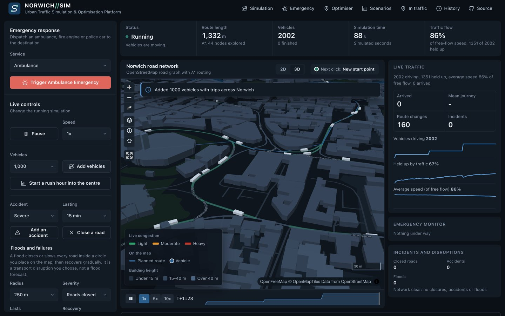

# Operations view: redesign

A redesign of NORWICH//SIM's dashboard and 3D map towards a transport-operations and digital-twin interface:
- a dark, restrained theme;
- a map-first layout with live monitoring beside the map and a timeline under it;
- a basemap built from real map data;
- every simulated vehicle drawn as a 3D body on the real shape of its road, facing its direction of travel.

Everything drawn comes from the simulation or from OpenStreetMap: no decorative or invented traffic.

## Before and after

| Before | After |
|---|---|
|  |  |
|  |  |

Close up, 2,000 vehicles: each one a body on its road, following the road's curve, on the left-hand side:

The "before" shots were taken in headless software rendering at the start of this work. The "after" shots use the GPU, with 1,000 to 2,000 simulated vehicles.

## What changed

### Dashboard

- **Layout.** Controls on the left, as before. A large central map, with a compact status strip above it and a **timeline** below. A **monitoring column** on the right holds:
  - live traffic: compact figures and sparklines;
  - an **emergency monitor**: state, elapsed time, ETA, distance to go, route changes;
  - an **incidents and disruptions monitor**: closed roads, accidents, floods with their recovery, queues at signals, and stopped cars in CA runs.

  The analysis sections (optimiser, scenarios, resilience, history) follow below, across the full width. Under 1,360 px wide, the monitoring column moves below the map; on phones, everything stacks as before.
- **Theme.** A dark operations palette, made by redefining the existing design tokens: headings, surfaces, lines and status colours. Headings now use their own token. The few hard-coded light colours were converted.
- **Timeline.** Simulated time, play/pause and 1×/5×/10× (the same controls as the live panel), and a track of vehicles driving over time. Incidents are marked where closures or accidents began, from each step's summary. It doesn't scrub back through time (see limitations).

### 3D map

- **Our own basemap style** (`frontend/src/mapTheme.ts`), built on OpenFreeMap's OpenMapTiles vector data (OpenStreetMap). It draws:
  - water and waterways: the Wensum and the Yare;
  - parks, woods and residential land, kept dim;
  - roads styled by class: motorway and trunk brightest and widest, then primary, secondary/tertiary, minor and service;
  - railways, dashed;
  - sparse labels: river, main roads, place names.
- **Buildings.** Extruded from OpenStreetMap heights, with directional light and a vertical gradient for depth. The colour ramps by height.
- **Congestion along the real roads.** Each road's real shape comes from the OpenStreetMap download (below). Free-flowing traffic is a faint line; moderate and heavy congestion are bright, with a soft glow, so congestion reads at a glance.
- **Vehicles as 3D bodies.** From zoom 15, every simulated vehicle is an extruded box:
  - **size:** its real size (4.5 × 1.9 × 1.5 m for a car; larger and taller for emergency vehicles), drawn up to 3× larger when zoomed out so it stays visible;
  - **placement:** rotated to the heading the backend sends, and set 1.8 m left of the road's centre line, as UK traffic drives;
  - **colour:** ordinary traffic in a quiet grey; emergency vehicles in their service's colour (ambulance red, fire orange, police blue), with their lettered marker on top;
  - **overview:** below zoom 15, a small dot per vehicle.
- **Movement.** Vehicles glide between the backend's once-a-second updates, from their previous real position to the new one (about 20 frames a second), turning the short way. Above 3,000 vehicles they jump instead, to keep the map responsive.
- **Controls.** Zoom, rotate and tilt (compass), **fullscreen** (with the legend), layers, Inspect, reset view, and scale. All restyled for the dark theme, with dark popups.

### 2D map (the fallback)

Kept and working. It is darkened to match: OpenStreetMap's tiles are drawn through a display filter, and ordinary vehicles are smaller and quieter while emergency vehicles stay bold. Congestion is drawn along the real road shapes too.

## Data, sources and licences

| Data | Source | Licence | Cost |
|---|---|---|---|
| Basemap: water, land, roads, buildings, labels | OpenFreeMap, OpenMapTiles schema, from OpenStreetMap | ODbL (OpenStreetMap); attribution shown on the map | Free, no API key, no usage limits stated; no SLA |
| Road shapes (`data/osm/norwich_road_geometry.json.gz`, 190 KB) | The project's committed OpenStreetMap download, rebuilt by `python -m backend.routing.road_geometry` | ODbL, like the road graph | None |
| Fonts | OpenFreeMap's glyph server | Noto Sans (SIL Open Font Licence) | Free |

**Road shapes.** The road graph keeps only junctions, so the shape of each road is rebuilt by walking OpenStreetMap's node chains between junctions. That is the same simplification OSMnx did when it built the graph.
- **Coverage:** 99.7% of roads (10,850 of 10,881).
- **Accuracy:** their lengths match the simulation's road lengths to within 0.11% (median), so a vehicle's distance along a road is placed at the right point on its real shape.
- **Fallback:** the remaining 31 roads are drawn as straight lines.

**What the data doesn't have,** and so isn't claimed:
- **Terrain:** OpenFreeMap has no elevation tiles, and Norwich is low and flat.
- **Building types:** OpenMapTiles gives only height and an optional colour.
- **Real building heights for most buildings:** as reported for the 3D prototype, only 13% of central Norwich's buildings have a mapped height. The rest use OpenMapTiles' default, so the skyline is approximate.

No paid service was added.

## API changes (all additive)

- **`POST /simulation/step`:** each vehicle also has `road_latitude`, `road_longitude` (its position on the road's real shape) and `heading` (compass degrees). `latitude` and `longitude` are unchanged.
- **`GET /simulation/congestion?geometry=true`:** each road also has `path`, its real shape. Without the parameter the answer is exactly as before.

## Performance

Production build, real backend, Chromium on the M1's GPU (Metal), 1440 × 900 at 2× pixel density, Low Power Mode off, simulation at 1×. Eight seconds measured per case, at the overview (zoom 14.6) and close up (zoom 17, where the 3D bodies draw):

| Vehicles | Overview: frames/s, worst frame | Close up: frames/s, worst frame | Main-thread long tasks |
|---|---|---|---|
| 502 | 60, 17 ms | 60, 17 ms | none |
| 1,002 | 60, 17 ms | 60, 17 ms | none |
| 2,002 | 60, 17 ms | 60, 17 ms | none |
| 3,998 | 60, 17 ms | 60, 33 ms | none |

What keeps it fast:
- **Batching:** all vehicles are drawn by the GPU in two batched layers (dots and extruded bodies). One update re-sends one GeoJSON source per layer, not one object per vehicle.
- **Glide cost:** gliding re-sends the vehicles at about 20 frames a second, not every display frame, and switches off above 3,000 vehicles.
- **Unchanged sources:** only sources that changed are re-sent, as before.

The 3D code still loads only when someone picks 3D: the main bundle is 481 kB (143 kB compressed) and the 3D chunk 1,048 kB (279 kB compressed). Phones and slower machines weren't measured.

## Tests

All pass:
- **Backend:** 935, including new tests for road shapes and the step and congestion fields.
- **Frontend unit:** 151, including vehicle bodies (size, heading, left-hand placement, scale), gliding (straight line, shortest turn) and timeline marks.
- **Frontend interface:** 110, including the timeline, the monitors and pausing from the timeline.
- **End to end:** 18 (5 skipped, as before).
- **Lint and production build:** clean.

One end-to-end test clicked fixed fractions of the map to reach an unreachable junction. The new layout changed the map's size, so it now clicks a geographic point instead.

## Limitations and remaining work

1. **Queues in `simple` and `osm` are not physical.** Those models treat a vehicle as a point, so vehicles waiting at the same stop line are drawn on top of each other. Spacing isn't invented. The `ca` model's vehicles keep real spacing and queue cell by cell.
2. **Gliding is a straight line** between two real positions a second apart. On a sharp bend it cuts the corner slightly (a few metres at 30 mph).
3. **No playback scrubbing.** The timeline shows the run so far and controls live playback, but can't go back in time: that would need the client to keep vehicle snapshots, or the backend to store them.
4. **Lanes are not drawn.** Vehicles sit left of the road's centre line regardless of how many lanes the road has.
5. **Building heights are mostly estimates** (see above). There is no terrain.
6. **The theme is dark only.** There's no light-mode switch. The 2D map's tiles are darkened with a display filter, not a dark tile set.
7. **Not tested on phones** or on low-end hardware for frame rates. The layout reflows, but the map's 3D bodies and glide haven't been measured there.
8. **The emergency monitor shows the current emergency** (the one the dashboard dispatched), as the existing status endpoint reports. A list of every queued emergency would need the queue endpoint wired in.
