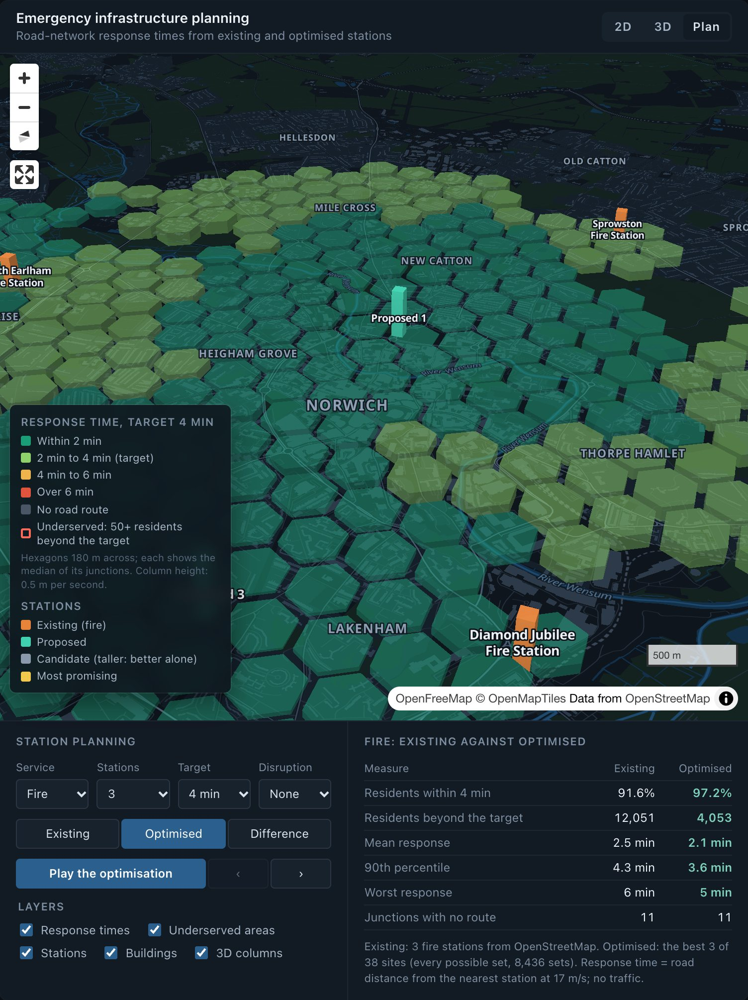
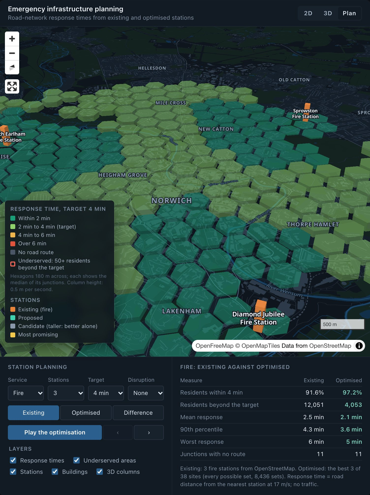
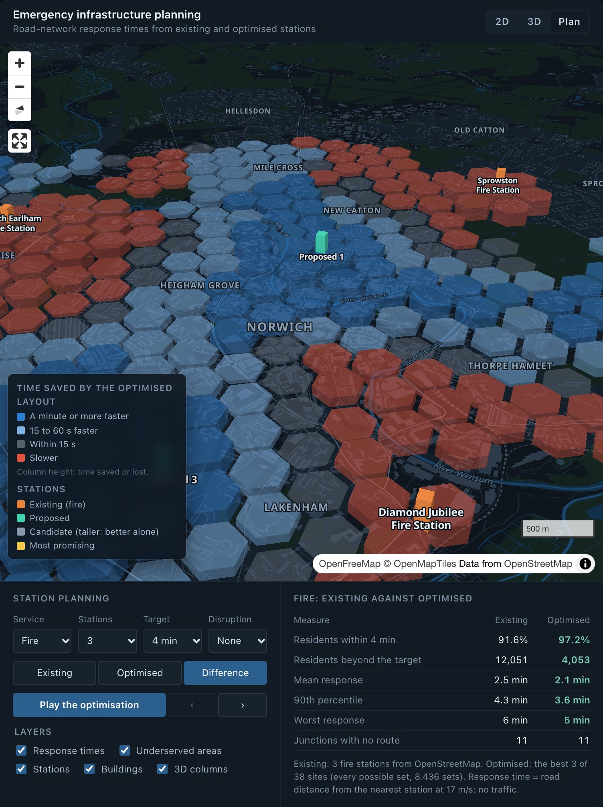
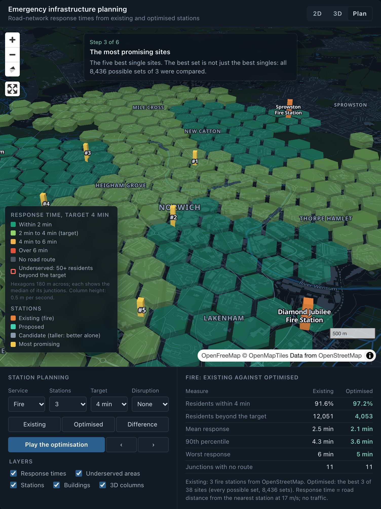

# Emergency infrastructure planning (3D)

The **Plan** view of the map compares where emergency response is fast or slow
across Norwich, on a 3D map, for the **existing** stations and for an
**optimised** layout. It also plays the optimiser's search step by step.

Everything on the map comes from one request, `GET /optimiser/plan`. The
backend for it is `backend/optimiser/planning.py`, and the drawing code is in
`frontend/src/planning.ts`, `planningLayers.ts`, `PlanningCanvas.tsx` and
`PlanningWorkspace.tsx`. The 2D optimiser view is unchanged.

## How a response time is calculated

The planner uses the optimiser's own model, unchanged
(`station_optimiser.py`):

- **Response time = shortest road distance from the nearest station ÷ the
  service's speed.** Distances come from Dijkstra over the Norwich road graph
  from OpenStreetMap. Closed roads are routed around. Nothing on the map is a
  straight-line distance: a test checks that every response time is at least
  the straight-line time (`test_response_time_is_the_nearest_stations_road_distance_over_speed`).
- **Speeds** are fixed per service (ambulance 20 m/s, fire 17 m/s, police
  22 m/s; `simulation/services.py`). The model has **no traffic,
  no junction delays and no turn-out time**.
- The time is worked out for **every junction** of the road graph, not only
  for the optimiser's 200 sampled emergencies. A junction with no road route
  to any station counts as unreachable. It is never left out, and always
  counts as beyond the target.

## The layouts compared

- **Existing:** the real stations for that service, as mapped in
  OpenStreetMap (`optimiser/existing_stations.py`, saved in
  `data/osm/norwich_emergency_stations.json`). Each is snapped to its nearest
  road junction, and any station more than 500 m from the network is left out.
  Norwich has 3 fire stations and 4 police stations mapped. **No road
  ambulance station is mapped**, so for ambulances there is no existing
  layout, and the view says so.
- **Optimised:** the optimiser's answer for the same settings
  (`best_station_set`). It picks from 38 candidate junctions spread over the
  city. When feasible it compares **every possible set** (8,436 sets for 3
  fire stations); otherwise it uses greedy search with swaps. It is a **fresh
  layout that replaces the existing stations**, not stations added to them.
  That is why the difference view shows some places near today's stations
  getting slower. A test checks that the planner's layout is exactly
  `optimise_station_set`'s answer
  (`test_the_optimised_layout_is_the_optimisers_own_answer`).

The optimiser chooses the set by its mean response to 200 emergencies sampled
in proportion to where people live. The coverage figures and maps then
measure that set over every junction, weighted by Census 2021 population, so
they also check the choice rather than simply repeat it.

## How it is drawn

- **Hexagons.** Junctions are grouped into pointy-top hexagons, 180 m from
  centre to corner. Each hexagon shows the **median** response time of the
  junctions inside it. The colour is the time against the target: within half
  the target, within the target, up to 1.5× the target, beyond that, or no
  road route. A hexagon with no junction is not drawn, so nothing is filled in
  where there are no roads. Hexagons are drawn at 86% of their size so that
  streets and buildings show between them; the values still cover the whole
  cell.
- **3D columns.** The height of each column is its response time (0.5 m per
  second). In the difference view the height is the time saved or lost
  (1.2 m per second). The **3D columns** switch turns the columns into flat
  hexagons. The columns are translucent, and 3D buildings stay on the map
  between and through them.
- **Underserved areas.** A red outline marks any hexagon with 50 or more
  residents beyond the target.
- **Stations.** Columns stand at each station: existing stations in the
  service's colour, proposed stations in teal, candidates in grey (the
  taller, the better that site is on its own) and the five best single
  sites in gold.
- **Figures.** A table compares the two layouts: residents within the target,
  residents beyond it, mean response, 90th percentile, worst response, and
  junctions with no route. The better value is highlighted.

## The optimisation, step by step

**Play the optimisation** (or the ‹ › buttons) walks through the steps
below. Every step shows the algorithm's real output, in the order it
produced it:

1. The existing stations and their coverage (when there are any).
2. All 38 candidate sites, each scored on its own.
3. The five most promising single sites, and how many sets were compared.
4. The chosen stations, added one at a time in the order they add the most
   (`order_by_contribution`). After each station the map shows the real
   coverage of the stations placed so far.

Between steps the hexagons morph from one real result to the next over
0.9 s. The in-between frames are interpolations, drawn only during that
transition. A hexagon that gains or loses its route keeps its starting value
until the end of the morph. The camera turns slightly at each step.

**Note:** the coverage after k stations is the coverage of the **first k
stations of the chosen set**. It is not the best possible k-station layout.

## Settings

The settings are service, number of stations (1–6), target time (2–15 min,
default 4 min) and disruption:

- **Wensum flood:** a 350 m circle by the river, with every road segment in
  it closed.
- **Bridges closed:** the central river crossings (Prince of Wales Road,
  Whitefriars, Fye Bridge Street, Duke Street).

These are the same disruptions as the resilience experiments
([RESILIENCE.md](RESILIENCE.md)). Under a disruption, both the existing
layout and the re-optimised one are measured on the disrupted network. Cut-off
hexagons stay on the map and show "no road route".

The default target is 4 minutes. At each service's own target (7, 8 or
15 minutes) every station layout reaches 100% of residents on this
uncongested model, so there would be nothing to compare.

## Verified results (fire, 3 stations, 4-minute target)

| Measure | Existing (3 OSM stations) | Optimised |
|---|---|---|
| Residents within 4 min | 91.6% | 97.2% |
| Residents beyond the target | 12,051 | 4,053 |
| Mean response | 2.5 min | 2.1 min |
| 90th percentile | 4.3 min | 3.6 min |
| Worst response | 6 min | 5 min |

The map has 385 hexagons. 11 junctions have no road route to any station
with no disruption; under the Wensum flood, 77 do.

| | |
|---|---|
|  |  |
| Existing stations | Difference: blue faster, red slower |

## What this does and does not claim

**It shows:** for this road graph, with constant speeds, how long the
shortest road route from the nearest station takes, and how that changes with
a different layout, more stations or a closed road.

**It does not predict real emergency response times.** In particular:

- There is no traffic, congestion, signal delay, crew turn-out time or
  call-handling time. Real times would be longer.
- One speed per service, on every road type.
- Station locations come from OpenStreetMap and may be incomplete. Ambulance
  services are run from hubs and standby points that are not mapped, so the
  ambulance view has only an optimised layout.
- The road graph covers Norwich's built-up area only. Stations and demand
  beyond it, and cover from neighbouring areas, are not modelled.
- A hexagon is a median of a few junctions over an area about 360 m across.
  It is not a value for every address in it.
- Population is Census 2021 output-area counts spread over junctions, not
  where people are at a given time.

## Tests

- `backend/tests/test_planning.py` covers hexagon membership and shape; that
  response time is the road distance over speed and never shorter than the
  straight line; unreachable junctions; hexagon medians; stage order and that
  coverage never gets worse as stations are added; repeatability and
  validation; agreement with the optimiser on Norwich; and that a flood keeps
  every hexagon on the map.
- `backend/tests/test_api.py` covers the endpoint and its validation.
- `frontend/tests/planning.test.ts` covers bands, hexagon features,
  difference features, the morph, the steps and the comparison.
- `frontend/tests/planningLayers.test.ts` creates, updates, shows, hides and
  removes the map layers on a stand-in map, removing layers before their
  sources.
- `frontend/ui-tests/planning.test.tsx` tests the workspace with the 3D map
  stubbed: the query, the figures, settings that trigger a new request, views,
  steps and play, errors, and the fall back to 2D when WebGL fails.
- `frontend/e2e/planning.spec.ts` uses real MapLibre and the real backend:
  columns, buildings and stations drawn, flat mode, steps, another service
  with a flood, and the difference view.

## Performance

The plan is worked out on request. The search from every station and
candidate is cached per disruption, so repeated requests are faster. The
endpoint counts as an expensive request for rate limiting, like the other
optimiser endpoints. Timings have not been recorded here: the machine was in
Low Power Mode during development, so any numbers would not be representative.
