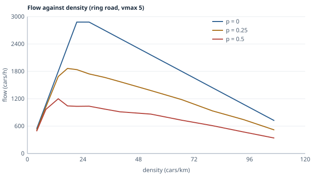
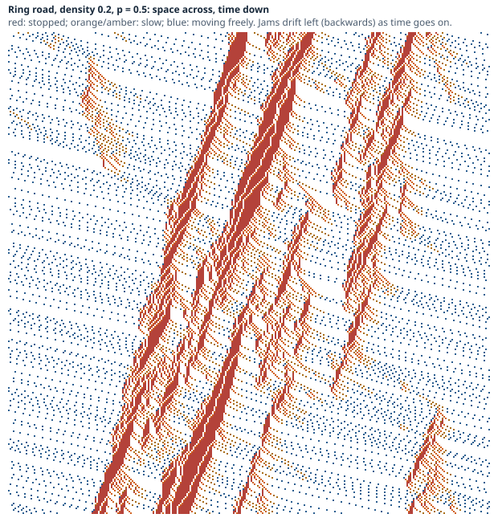
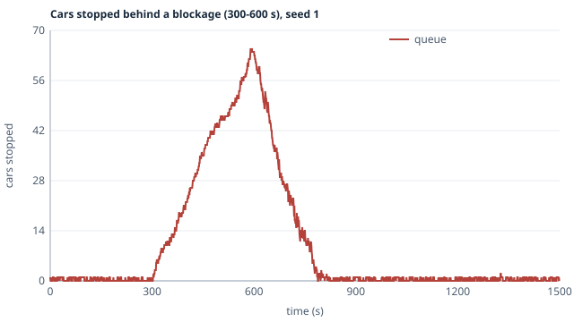
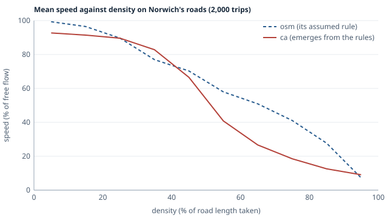

# Cellular automaton: experiments

Generated by `python -m backend.simulation.benchmark_cellular --save` on arm64 / Python 3.9.6 (2026-11-18), 11 minutes in all. Every experiment uses seeds 1, 2 and 3; figures are their mean unless a range is given. See [CELLULAR_AUTOMATON.md](CELLULAR_AUTOMATON.md) for the model and what these results mean.

## 1. Fundamental diagram (ring road, classic NaSch)

500 cells of 7.5 m (3.75 km), vmax 5 cells per second (37.5 m/s), cars evenly spaced at the start, 500 s to settle, then 500 s measured. Flow is cars passing a point; per lane.

| p | Density (cars/km) | Flow (cars/h) | Mean speed (km/h) | Cars stopped |
|---|---|---|---|---|
| 0 | 4 | 540 | 135.0 | 0% |
| 0 | 8 | 1,080 | 135.0 | 0% |
| 0 | 13 | 1,800 | 135.0 | 0% |
| 0 | 17 | 2,340 | 135.0 | 0% |
| 0 | 21 | 2,880 | 135.0 | 0% |
| 0 | 27 | 2,880 | 108.0 | 0% |
| 0 | 33 | 2,700 | 81.0 | 0% |
| 0 | 40 | 2,520 | 63.0 | 0% |
| 0 | 53 | 2,160 | 40.5 | 0% |
| 0 | 67 | 1,800 | 27.0 | 0% |
| 0 | 80 | 1,440 | 18.0 | 33% |
| 0 | 93 | 1,080 | 11.6 | 57% |
| 0 | 107 | 720 | 6.8 | 75% |
| 0.25 | 4 | 506 | 128.1 | 0% |
| 0.25 | 8 | 1,022 | 127.8 | 0% |
| 0.25 | 13 | 1,687 | 126.6 | 0% |
| 0.25 | 17 | 1,865 | 107.0 | 7% |
| 0.25 | 21 | 1,838 | 85.3 | 16% |
| 0.25 | 27 | 1,745 | 64.6 | 24% |
| 0.25 | 33 | 1,668 | 49.3 | 32% |
| 0.25 | 40 | 1,574 | 38.8 | 39% |
| 0.25 | 53 | 1,380 | 25.7 | 48% |
| 0.25 | 67 | 1,181 | 17.6 | 56% |
| 0.25 | 80 | 934 | 12.1 | 64% |
| 0.25 | 93 | 744 | 7.9 | 74% |
| 0.25 | 107 | 516 | 4.8 | 83% |
| 0.5 | 4 | 487 | 121.3 | 0% |
| 0.5 | 8 | 967 | 120.9 | 0% |
| 0.5 | 13 | 1,200 | 87.8 | 17% |
| 0.5 | 17 | 1,044 | 64.3 | 29% |
| 0.5 | 21 | 1,034 | 50.8 | 39% |
| 0.5 | 27 | 1,037 | 39.0 | 45% |
| 0.5 | 33 | 974 | 30.6 | 50% |
| 0.5 | 40 | 914 | 24.0 | 55% |
| 0.5 | 53 | 864 | 15.9 | 63% |
| 0.5 | 67 | 730 | 10.9 | 71% |
| 0.5 | 80 | 610 | 7.5 | 77% |
| 0.5 | 93 | 473 | 5.0 | 83% |
| 0.5 | 107 | 338 | 3.1 | 89% |

- p = 0: maximum flow 2,880 cars/h at 21 cars/km.
- p = 0.25: maximum flow 1,865 cars/h at 17 cars/km.
- p = 0.5: maximum flow 1,200 cars/h at 13 cars/km.

## 2. Stop-and-go waves

Ring road of 300 cells at density 0.2 (27 cars/km), 300 s settling, then 300 s recorded. Wave speed: the shift that best lines up the stopped cars with where they are 10 s later.

| p | Cars stopped | Jam movement (km/h) | Range over seeds (km/h) |
|---|---|---|---|
| 0 | 0.0% | n/a | n/a to n/a |
| 0.25 | 24.8% | -18.9 | -18.9 to -18.9 |
| 0.5 | 43.1% | -10.8 | -10.8 to -10.8 |

## 3. A queue behind a blockage

A 3 km single-lane road (400 cells), cars arriving at the start 15 a minute on average, p = 0.25. The road is blocked 750 m from its end from 300 s to 600 s.

| Measure | Result |
|---|---|
| Longest queue (cars stopped) | 70 |
| Queue growth in the last 5 minutes of the blockage | 13.7 cars/min (arrivals: 15 cars/min) |
| Time to clear after reopening | 170 s (157-178 s) |
| Flow out of the queue (first 2 minutes) | 1,940 cars/h |

## 4. Norwich: osm against ca

The scenario engine (`backend/scenarios/runner.py`), trips leaving over the first 5 minutes, dynamic rerouting on. The same seed gives the same trips in both models. Delay is measured against each model's own free flow (osm: the speed limit; ca: the limit rounded to whole cells per second).

| Trips | Model | Completed | Mean delay (s) | 95th pct delay (s) | Mean journey over free flow at the limits (s) | Mean speed (of free flow) | Route changes | Simulated (s) | Runtime (s) | ms per simulated s |
|---|---|---|---|---|---|---|---|---|---|---|
| 500 | osm | 100.0% | 5.5 | 16.8 | 6.1 | 99% | 0 | 980 | 6.3 | 6.5 |
| 500 | ca | 100.0% | 18.7 | 30.6 | 18.2 | 95% | 12 | 987 | 6.4 | 6.5 |
| 1,000 | osm | 100.0% | 11.4 | 31.0 | 12.3 | 97% | 12 | 1,004 | 13.8 | 13.8 |
| 1,000 | ca | 100.0% | 20.3 | 35.4 | 19.8 | 94% | 44 | 1,026 | 14.6 | 14.2 |
| 2,000 | osm | 100.0% | 29.0 | 88.1 | 35.4 | 92% | 494 | 1,184 | 41.8 | 35.3 |
| 2,000 | ca | 100.0% | 31.4 | 72.5 | 34.0 | 91% | 465 | 1,140 | 35.1 | 30.9 |

### The busiest roads closed (Grapes Hill, Chapelfield Road, Grapes Hill)

1,000 trips; the three roads that lost the most time in the osm baseline (seed 1), closed for the whole run.

| Model | Mean delay, open (s) | Mean delay, closed (s) | Change | Route changes, closed | Completed, closed |
|---|---|---|---|---|---|
| osm | 11.4 | 13.1 | 1.6 | 37 | 100.0% |
| ca | 20.3 | 20.8 | 0.5 | 56 | 100.0% |

Repeatable: the same ca scenario run twice gave identical journey times.

## 5. Speed against density on Norwich's roads

2,000 trips, 15 simulated minutes, every road at least 30 m long with cars on it sampled every 10 s. Density is the share of the road's length (all lanes) its cars take at 7.5 m each. osm's speed is its rule (Greenshields' line over a road at least 30 m long, with a 5% floor); ca's is the cars' measured mean speed.

| Density | osm: mean speed (samples) | ca: mean speed (samples) |
|---|---|---|
| 0-10% | 99% (19,027) | 93% (18,042) |
| 10-20% | 97% (12,777) | 91% (13,961) |
| 20-30% | 90% (4,358) | 90% (5,492) |
| 30-40% | 77% (1,377) | 83% (1,377) |
| 40-50% | 70% (711) | 67% (515) |
| 50-60% | 58% (211) | 41% (133) |
| 60-70% | 51% (148) | 27% (116) |
| 70-80% | 41% (102) | 18% (46) |
| 80-90% | 28% (53) | 13% (38) |
| 90-100% | 7% (413) | 9% (20) |

